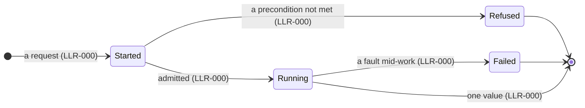
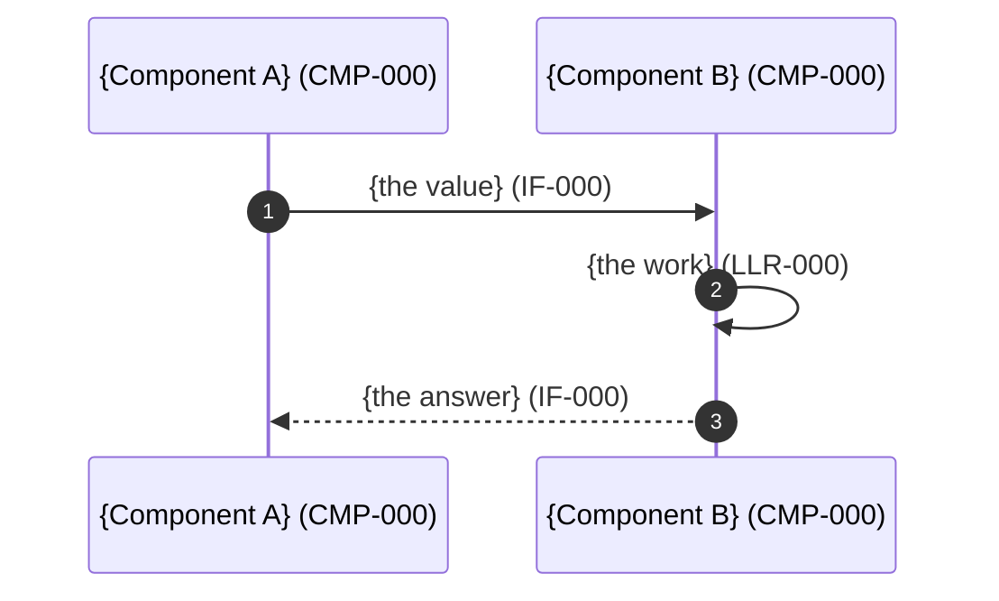

# Runtime flows — {project} (authored with the LLRs, before the test-case review)

The authored half of the architecture record: each diagram renders a runtime
scenario from the design tier and cites the SR, LLR and IF ids it renders. The
structural half is the registries (`docs/requirements/components.toml`,
`interfaces.toml`, `low-level-requirements.toml`). Where a row and a flow
disagree, the row wins and the flow is fixed in the same change.

Conventions (the checker `check_design_layer.py` relies on them):
- Every flow sits under the `## Runtime flows` heading, one `###` per flow.
- Participants are components, with exactly one id in the label:
  `participant Pub as Publication (CMP-011)`. An actor outside the system uses
  `actor`.
- A message between two components cites the **interface** it travels on
  (`Scan->>Pub: the change set (IF-049)`). A self-message cites the **LLR**
  being performed (`Scan->>Scan: compare size and time (LLR-113)`). A request
  credits the receiver, and a reply (`-->>`) the sender.
- Each scope has a state flow (`stateDiagram-v2`): the modes a stakeholder
  could name, the transitions, and the failure endings.
- Always draw the concurrent and asynchronous behaviour.
- Mermaid hazards: `Note` is a keyword and can't be a participant alias; no
  `;` in message text; keep to one colon per message.

## Runtime flows

### 0. {The launch, or the top scope}: the modes

### 1. {A scenario}, in order

## Requirements no flow renders (declared flow-free)

SRs that state a static rule (a check made once against a document, a form, a
package or a pair of versions) rather than an ordering, so no flow renders them:

- **{Group}:** SR-000, SR-000.
