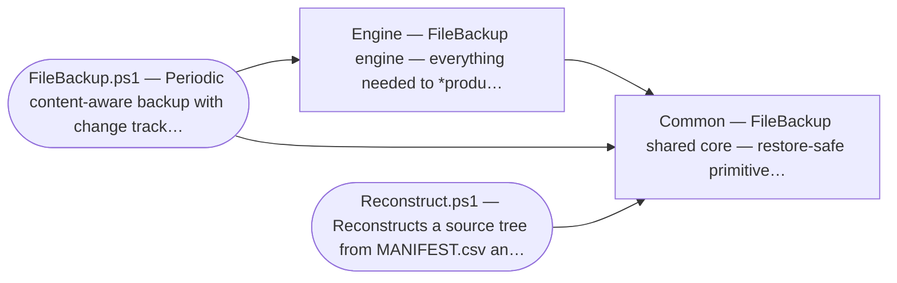

# AGENTS.md — contributor & agent guide

Everything needed to safely modify FileBackup. Users who just want to run it should read
[README.md](README.md); this file is the single source for architecture, invariants,
conventions, the test matrix, and history.

---

## 1. What this is

A Windows **PowerShell 7+** content-aware backup tool. `FileBackup.ps1` walks a source
tree, hashes files with xxHash128 (`System.IO.Hashing`), deduplicates by `(hash, size)`,
optionally 7-Zip-compresses, and records `MANIFEST.csv`. A run that supersedes earlier
content preserves it in a dated `Snapshot_<date>` folder (named by the superseded backup's
completion date — see §3) and drops a self-contained restore kit. `Reconstruct.ps1`
rebuilds the tree byte-exact from the backup root (latest state) or any snapshot
(that point in time) alone.

The backup run is the **bounded run loop** of
[docs/plans/bounded-run-loop.md](docs/plans/bounded-run-loop.md) (the Owner's
rulings R1–R14 and calls C1–C8): a corner case warns and the run carries on, the
files on disk are the truth, and the next run repairs from them. Concurrent runs
are unsupported; one OS lock refuses a second one.

## 2. Architecture & module map

| File | Role | Bundled into backups? |
|---|---|---|
| `Modules/FileBackup.Common.psm1` | **Restore-safe primitives**: `Get-FileXxHash`, `Initialize-XxHashLibrary`, `Get-XxHashDllPath`, `Read-/Write-Manifest`, `Compress-/Expand-FileWithSevenZip`, `Test-ShouldCompress`, short-name encoding, `New-Logger`, `Get-FileBackupDefaults`, `Get-FreeSpaceBytes`/`Get-VolumeIdentity` (SR-052 — both restorer and engine measure capacity through these). | **Yes** |
| `Modules/FileBackup.Engine.psm1` | **Backup-only logic**: the **bounded backup run** — `Invoke-BackupSet`, `Get-SourceFileList`, `Get-StoreObjectIndex` (+ the prefix-only name reader `ConvertFrom-StoredObjectName`), `Invoke-SourceFileCapture`, `Copy-FileWithHash`, `Publish-StagedObject`, `Publish-PriorStateSnapshot`, `Move-SupersededObject`, `Assert-SingleStoreMount`, `Clear-InterruptedRunResidue`, the OS lock (`Enter-/Exit-StagingOsLock`) — and `New-ReconstructScript`, `Test-HashRecalcDue`, `Test-IsInfrastructureFile`, `Get-BackupContentIndex` (read by retention and the audit), … plus the **retention mechanism** (SR-045..047): `Get-SnapshotPrunePlan`, `Get-BackupSnapshot`, `Assert-PrunePrecondition`, `Get-PruneCapacityRefusal`, `Test-PoolResolves`, `Copy-ReHomedDataFile`, `Publish-PruneManifest`, `Remove-CommittedPruneResidue`, `Invoke-PruneEntrySweep`, `Complete-PruneDeletion`, `Remove-BackupSnapshot`; and the **storage-form audit** (SR-049): `Get-StoredFileForm`, `Test-StorageFormAgreement`, `Get-StorageFormFinding`, `Get-BackupKitRevision`, `Test-BackupStorageForm`, `Repair-BackupStorageForm`, `Update-BackupSnapshotKit`, and the object-level audit `Get-StoreObjectFinding` / `Move-StoreObjectToVerify` (plan R9, C4); and the **browse view** (SR-062): `New-BrowseViewIndex`. | No |
| `FileBackup.ps1` | Thin entry point: import modules, read config, then either loop `Invoke-BackupSet` (+ optional mail) or, under `-Action Prune`/`-Action Snapshots` (SR-048) / `-Action Verify` (SR-049) / `-Action View` (SR-062), dispatch the one configured set to the retention mechanism, the storage-form audit or a forced browse-view rebuild. | n/a |
| `Reconstruct.ps1` | Standalone restore; imports the **bundled** Common module. | itself |
| `bash/reconstruct.sh` | **Linux/bash standalone restore** (phase `bash-v1`): one self-contained POSIX-shell file (bash 4+, gawk, xxhsum, 7z) that restores byte-exact from a backup folder on a host with no PowerShell, mirroring `Reconstruct.ps1`'s semantics against the *same* MANIFEST.csv contract. It is **not** in the generated map below (that map is PowerShell-AST-only); its internal functions (`hash_file`, `parse_manifest`, `to_posix`) are unit-tested by sourcing it under bats. See §4 for the tooling floor and README "Restore on Linux". | **Yes** |
| `Dockerfile`, `container/`, `scripts/Invoke-Container.ps1` | **Linux container runtime and lifecycle** (phase `container-v1`): digest-pinned non-root image, JSON configuration entrypoint, compressed build/restore smoke test, offline tar export, and optional OCI registry publish/pull. | n/a |

**The Common/Engine split is load-bearing.** `New-ReconstructScript` copies
`Reconstruct.ps1`, `reconstruct.sh`, `FileBackup.Common.psm1`,
`System.IO.Hashing.dll`, and a `RECONSTRUCT.paths.json` sidecar into each backup
folder so a restore needs nothing else. No manifest witness is written any more
(plan R5): a folder an older build wrote may still hold a `MANIFEST.csv.meta`,
which `Write-Manifest` deletes when it rewrites that folder's manifest and which
no kit from revision 14 reads (see §3).
Therefore:

- Anything `Reconstruct.ps1` calls **must live in Common**, not Engine.
- **Common must never depend on Engine.**

### Backup pipeline (`Invoke-BackupSet`, per set, per run)

The bounded run loop (plan §3). Every step is ordered so that a kill at any
point leaves every visible state restorable, and the next run repairs from the
files; `BoundedRun.Tests.ps1` kills a run at each stage and proves it.

1. **Lock and clean up.** Resolve the paths (a failure is 2). Take the OS lock,
   `<ChangePath>/Temp.lock` opened `FileShare.None` (SR-085); held → 4, and the
   refusal is APPENDED to `backup.log`, which belongs to the holder. Then refuse
   with 2, changing nothing, a bad `CompressProbe`, a store a rename cannot
   cross (`Assert-SingleStoreMount`, R8), a latest manifest with a foreign
   header, or a store in a retired form (`Assert-CurrentStoreForm`, SR-061).
   Delete what a killed run left (`Clear-InterruptedRunResidue`: `Incoming/`,
   `Building_*`); an older engine's `Temp` is warned about and left alone.
2. **Read and index.** The prior date D (`LastBackupRun`; a missing or unreadable
   state file warns and falls back to the manifest file's time) and the latest
   manifest, which is the only change-detection record (R3). One listing of the
   backup root and every snapshot builds the object index by name
   (`Get-StoreObjectIndex`); snapshot manifests are never read by a run.
3. **Publish the prior state first** (`Publish-PriorStateSnapshot`): its manifest
   with every DataPath blanked, its directory record and the current kit go into
   `Building_<D>`, renamed to `Snapshot_<D>`. It restores at once, because every
   object it needs is still in the pool. An existing `Snapshot_<D>` is kept.
4. **Library loop** (`Invoke-SourceFileCapture`). A file whose size and time
   match its row, with no re-read due, keeps its row. Any other is hashed while
   it is copied (`Copy-FileWithHash`), staged by how likely it is new (plan §4),
   then reused, moved back from a snapshot by rename, or stored
   (`Publish-StagedObject`, which decides the form from the staged copy, SR-081).
   Progress is checkpointed into `MANIFEST.csv` (R13). Unportable names (SR-055)
   and unlistable folders (SR-057) are warned about and keep their rows.
5. **Retry pass** (R12): a failed file again no sooner than 60 s after its last
   attempt, 3 attempts in all; then a warning, its earlier row kept (SR-091).
6. **Finish latest**: the canonical manifest (ordinal `RelativePath` order, every
   text column a string, so an unchanged run rewrites identical bytes), the
   directory sidecar, then `LastBackupRun` / `LastHashRun`.
7. **Discard an unneeded snapshot**: no row changed and this run built it → it is
   deleted (it holds no objects yet).
8. **Move superseded content** (`Move-SupersededObject`): every object no row of
   the FINAL manifest uses moves into `Snapshot_<D>` by rename. Nothing is ever
   deleted (R9).
9. **Browse view** (SR-062), then release the lock in the `finally`.

The set returns **0** every file captured, **1** completed with files not
captured, **2** refused before anything changed, **4** stopped by a host problem
or a held lock; `FileBackup.ps1` folds the sets with precedence 2 > 4 > 1.

### Generated dependency diagram & function map

The table above is the hand-kept editorial overview; the regions below are
**generated from the source AST** by `scripts/gen_arch_map.ps1` (the Mermaid
call-graph between modules/entry scripts, then per-module summary, internal
cross-module dependencies, and every function with its `Implements:` back-links).
Do not edit them by hand — `check.ps1` fails if they are stale. The same blocks
are mirrored in [docs/architecture.md](docs/architecture.md), which also carries
the generated `Invoke-BackupSet` flow.

<!-- BEGIN GENERATED DEPENDENCY DIAGRAM -->
_Generated by `scripts/gen_arch_map.ps1`: each arrow is a call into another
in-tree module. An arrow from `Common` into `Engine`, or from `Reconstruct.ps1`
into `Engine`, would violate the AGENTS.md §3 invariants. Do not edit by hand._


<!-- END GENERATED DEPENDENCY DIAGRAM -->

<!-- BEGIN GENERATED MODULE MAP -->
_Generated by `scripts/gen_arch_map.ps1` from the modules' AST. Do not edit by hand;
run the generator. Summary = the module's .SYNOPSIS; back-links come from `Implements:` comments._

### `Modules/FileBackup.Common.psm1`

_FileBackup shared core — restore-safe primitives._
Imports (internal): _none_

| Function | Exported | Implements |
|---|:---:|---|
| `Compress-FileWithSevenZip` | yes | SR-004, LLR-004 |
| `Convert-HexToShortName` | yes | SR-003, SR-069, LLR-003, LLR-069 |
| `Convert-ShortNameToHex` | yes | SR-003, SR-069, LLR-003, LLR-069 |
| `ConvertFrom-HashSizeFileName` | yes | SR-069, SR-070, LLR-069 |
| `ConvertFrom-ManifestDateString` | yes | — |
| `ConvertTo-DirectoryAttributeFlag` | yes | SR-065, LLR-065 |
| `ConvertTo-ManifestDateString` | yes | SR-025, LLR-025 |
| `Expand-FileWithSevenZip` | yes | SR-008, LLR-008 |
| `Get-DirectoryAttributeToken` | yes | SR-065, LLR-065 |
| `Get-FileBackupDefaults` | yes | — |
| `Get-FileXxHash` | yes | SR-002, LLR-002 |
| `Get-FreeSpaceBytes` | yes | SR-052, SR-023, LLR-052, LLR-023 |
| `Get-HashSizeFileName` | yes | SR-003, SR-021, SR-069, SR-070, LLR-003, LLR-021, LLR-069, LLR-070 |
| `Get-ManifestWitnessPath` | yes | SR-038, LLR-038 |
| `Get-StoredObjectForm` | yes | SR-068, LLR-068 |
| `Get-VolumeIdentity` | yes | SR-052, LLR-052 |
| `Get-XxHashDllPath` | yes | SR-007, LLR-007 |
| `Initialize-ManifestRowWriter` | no | SR-025, LLR-025 |
| `Initialize-XxHashLibrary` | yes | SR-002, SR-019, LLR-002 |
| `New-Logger` | yes | — |
| `New-RelativePathMap` | yes | SR-034, LLR-034 |
| `Read-Manifest` | yes | SR-025, LLR-025 |
| `Resolve-ExistingAncestor` | yes | SR-052, SR-023, LLR-052 |
| `Test-HashSizeFileName` | yes | SR-061, SR-069, LLR-069 |
| `Test-IsVolumeRootPseudoPath` | yes | SR-074, LLR-078 |
| `Test-LegacyStoredObjectName` | yes | SR-061, SR-069, LLR-069 |
| `Test-ManifestWitness` | yes | SR-039, LLR-039 |
| `Test-ShouldCompress` | yes | SR-004, LLR-004 |
| `Write-Manifest` | yes | SR-025, SR-082, LLR-025, LLR-087 |
| `Write-ManifestWitness` | yes | SR-038, LLR-038 |

### `Modules/FileBackup.Engine.psm1`

_FileBackup engine — everything needed to *produce* a backup._
Imports (internal): `Common`

| Function | Exported | Implements |
|---|:---:|---|
| `Assert-CurrentStoreForm` | no | SR-061, LLR-060 |
| `Assert-NoUnknownConfigKey` | no | SR-042, LLR-042 |
| `Assert-PrunePrecondition` | yes | SR-046, SR-035, SR-039, LLR-046 |
| `Assert-SingleStoreMount` | yes | SR-059, LLR-150 |
| `Clear-InterruptedRunResidue` | no | SR-017, SR-075 |
| `Complete-PruneDeletion` | yes | SR-046, LLR-046 |
| `ConvertFrom-StoredObjectName` | yes | SR-069, LLR-069 |
| `ConvertTo-FrozenRow` | no | SR-091, SR-059 |
| `Copy-FileWithHash` | yes | SR-002, SR-059, LLR-002 |
| `Copy-ReHomedDataFile` | yes | SR-045, LLR-045 |
| `Enter-StagingOsLock` | yes | SR-085, SR-086, SR-087, LLR-090 |
| `Enter-StoreMutationLock` | no | SR-085, SR-086, LLR-094 |
| `Exit-StagingOsLock` | yes | SR-085, SR-087, LLR-090, LLR-093 |
| `Get-BackupContentIndex` | yes | SR-026, SR-045, SR-047, LLR-047 |
| `Get-BackupKitRevision` | yes | SR-049, LLR-049 |
| `Get-BackupSnapshot` | yes | SR-047, LLR-047 |
| `Get-ConfigValueJsonTypeName` | no | SR-042, LLR-042 |
| `Get-DataFile` | yes | SR-057, SR-074, LLR-057, LLR-078 |
| `Get-FolderFileSet` | no | SR-064, LLR-062 |
| `Get-LastBackupRun` | yes | SR-005, SR-028, LLR-005, LLR-028 |
| `Get-LastHashRun` | yes | SR-011, LLR-011 |
| `Get-LatestObject` | no | SR-003, SR-053, SR-108 |
| `Get-MediaMBPerSec` | yes | SR-020, LLR-020 |
| `Get-PoolSnapshotFolder` | yes | SR-045, LLR-045 |
| `Get-PriorBackupDate` | no | SR-005, SR-035, LLR-005, LLR-035 |
| `Get-PruneBatchExitCode` | yes | SR-040, SR-046, SR-048, LLR-046, LLR-048 |
| `Get-PruneCapacityRefusal` | yes | SR-046, SR-052, LLR-046 |
| `Get-SnapshotDate` | no | SR-047, LLR-047 |
| `Get-SnapshotPrunePlan` | yes | SR-045, SR-047, LLR-045, LLR-047 |
| `Get-SortedManifestRow` | yes | SR-024, SR-025 |
| `Get-SourceDirectoryRecord` | yes | SR-065, LLR-065 |
| `Get-SourceFileList` | yes | SR-001, SR-055, SR-057, SR-074, LLR-001, LLR-055, LLR-057 |
| `Get-StagingOsLockPath` | yes | SR-085, SR-087, LLR-090, LLR-093 |
| `Get-StorageFormFinding` | yes | SR-049, LLR-049 |
| `Get-StoredFileForm` | yes | SR-049, LLR-049 |
| `Get-StoredObjectCompressedFlag` | no | SR-068, LLR-068 |
| `Get-StoredObjectPrefix` | yes | SR-069, LLR-069 |
| `Get-StoredObjectVerdict` | yes | SR-049, SR-068, LLR-049 |
| `Get-StoreObjectFinding` | yes | SR-003, SR-049, LLR-049 |
| `Get-StoreObjectIndex` | yes | SR-003, SR-053, SR-108 |
| `Import-BackupConfiguration` | yes | SR-042, LLR-042 |
| `Initialize-Dependencies` | yes | SR-019 (required dep), SR-020 (optional deps), SR-016 (non-blocking) |
| `Invoke-BackupRunTestHook` | no | — |
| `Invoke-BackupSet` | yes | SR-001, SR-005, SR-014, SR-036, SR-055, SR-057, SR-085, SR-086, SR-089, SR-091, SR-100, LLR-014, LLR-091 |
| `Invoke-LibraryCapture` | no | SR-001, SR-055, SR-057, SR-067, SR-089, SR-091, LLR-091 |
| `Invoke-PruneEntrySweep` | yes | SR-046, LLR-046 |
| `Invoke-SourceFileCapture` | yes | SR-001, SR-003, SR-011, SR-053, SR-059, SR-067, SR-091, SR-105, SR-108 |
| `Invoke-StagingTestHook` | no | SR-075, LLR-017 |
| `Measure-SampleCompressibility` | no | SR-081, LLR-086 |
| `Move-StoreObjectToVerify` | yes | SR-049, SR-109, LLR-049 |
| `Move-SupersededObject` | yes | SR-005, SR-041, SR-059, LLR-059, LLR-150 |
| `New-BackupRunContext` | no | SR-011, SR-081, LLR-014 |
| `New-BrowseViewIndex` | yes | SR-062, LLR-061 |
| `New-CapturedRow` | no | SR-025, SR-024 |
| `New-ProbeStatistic` | no | SR-081, LLR-086 |
| `New-ReconstructScript` | yes | SR-007, LLR-007 |
| `Publish-LatestState` | no | SR-005, SR-011, SR-065, LLR-005 |
| `Publish-PriorStateSnapshot` | yes | SR-005, SR-007, SR-010, SR-082, LLR-005, LLR-150 |
| `Publish-PruneManifest` | yes | SR-045, SR-038, LLR-045 |
| `Publish-StagedObject` | no | SR-003, SR-004, SR-058, SR-081, LLR-003, LLR-058, LLR-086 |
| `Read-BackupState` | no | SR-011, SR-028, LLR-011, LLR-028 |
| `Read-PriorStateForRun` | no | SR-042, SR-061, SR-081, LLR-014 |
| `Remove-BackupSnapshot` | yes | SR-045, SR-046, SR-040, SR-085, SR-086, LLR-045, LLR-046, LLR-092 |
| `Remove-CommittedPruneResidue` | yes | SR-046, LLR-046 |
| `Remove-UnchangedSnapshot` | no | SR-100, LLR-150 |
| `Repair-BackupStorageForm` | yes | SR-049, SR-024, SR-038, SR-085, SR-086, LLR-049, LLR-094 |
| `Resolve-BackupSetDefaults` | no | SR-042, LLR-042 |
| `Resolve-BackupSetPaths` | yes | SR-014, SR-049, SR-063, LLR-014, LLR-063 |
| `Resolve-CompressionDecision` | no | SR-081, LLR-086 |
| `Resolve-GroupStorageForm` | no | SR-081, LLR-058, LLR-086 |
| `Resolve-OptionalTool` | yes | SR-020 (optional-dependency degradation), SR-016 (non-blocking) |
| `Resolve-ViewRootPath` | no | SR-063, LLR-063 |
| `Set-BackupStateField` | no | — |
| `Set-LastBackupRun` | yes | SR-005, SR-028, LLR-005, LLR-028 |
| `Set-LastHashRun` | yes | SR-011, LLR-011 |
| `Test-BackupConfigurationShape` | no | SR-042, LLR-042 |
| `Test-BackupDiskFull` | no | SR-052, LLR-052 |
| `Test-BackupStorageForm` | yes | SR-049, SR-038, SR-040, SR-061, LLR-049, LLR-060 |
| `Test-ConfigValueJsonType` | no | SR-042, LLR-042 |
| `Test-FolderHoldsFile` | no | SR-064, LLR-062 |
| `Test-HashRecalcDue` | yes | SR-011, LLR-011 |
| `Test-IsInfrastructureFile` | yes | SR-022, SR-038, LLR-022, LLR-038 |
| `Test-IsJsonNumber` | no | SR-042, LLR-042 |
| `Test-PoolResolves` | yes | SR-046, SR-045, LLR-046 |
| `Test-PortableRelativePath` | yes | SR-055, LLR-055 |
| `Test-StateChanged` | no | SR-005, SR-100, LLR-005 |
| `Test-StorageFormAgreement` | yes | SR-046, SR-049, LLR-046, LLR-049 |
| `Update-BackupSnapshotKit` | yes | SR-049, SR-007, SR-038, SR-085, SR-086, LLR-049, LLR-094 |
| `Write-DirectorySidecar` | yes | SR-065, LLR-065 |
| `Write-ProbeStatistic` | no | SR-081, LLR-086 |
<!-- END GENERATED MODULE MAP -->

## 3. Invariants — do not break

> **The 2026-08-24 bench defects are all CLOSED.** D-2 (restore trusted a
> resolvable `DataPath` without hashing), D-3 (exit-code misclassification) and
> D-4 (hidden/dot files never enumerated) were fixed in **kit revision 6**,
> 2026-08-24: both restorers verify every file they write against the row's
> `(Length, xxH2Hash)` and heal from the pool once (`ContentMismatch`, SR-056);
> an unexpandable **pool candidate** is content damage (exit 1), not a host
> problem; every PowerShell-side enumeration carries `-Force` (SR-057).
> **D-1 and D-5 were fixed by WP9 (2026-08-25) by deleting their hazard class:
> ALL storage is content-addressed, the Mirror/`PreserveFolderTree` layout is
> gone, and browsability is a generated view outside the backup root.** Records:
> [docs/defect-review-2026-08-24-mirror-dedup.md](docs/defect-review-2026-08-24-mirror-dedup.md)
> (the findings),
> [docs/plans/option3-content-addressed-storage-plan.md](docs/plans/option3-content-addressed-storage-plan.md)
> (the design ruling) and
> [docs/plans/wp9-content-addressed-storage-workorder.md](docs/plans/wp9-content-addressed-storage-workorder.md)
> (the implementation). The invariants below document the CURRENT code.

- **Manifest schema** (9 columns): `DataPath, RelativePath, Length, LastWriteTimeStr,
  xxH2Hash, Compressed, StoredAsHashSize, Duplicate, MediaMBPerSec`. Round-trip only via
  `Read-Manifest`/`Write-Manifest`.
- **Dedup key is `(xxH2Hash, Length)`** — one physical data file per key, across
  runs *and within a single run* (SR-003/SR-060). The first file in walk order
  whose content is new decides that object's extension and form; every later
  file with the same content adopts it. Content found only in a snapshot is
  moved back into the backup root by rename rather than stored again.
- **All storage is content-addressed** (SR-058): every data file is named
  `Get-HashSizeFileName(hash, length, ext)` — `"<hash16> <len10><ext>"` — flat at
  the backup root, and every row carries `StoredAsHashSize='Hash'` (SR-013).
  There is no path-addressed (Mirror) layout and no configuration key selects
  one. This is what makes the store safe rather than merely checked: **different
  content yields a different filename, so a stored object can never be
  overwritten in place.**
- **Stored objects are immutable and name-proven** (SR-059). No run changes the
  bytes at a `DataPath` any live manifest row still claims, and an object is only
  ever created at a name its own bytes justify: `Copy-FileWithHash` hashes the
  bytes it writes, and the object is named after THAT hash, never after an
  earlier read. Exactly one step moves bytes out of the backup root,
  `Move-SupersededObject`, and it asks of the **final** manifest whether any row
  still claims the object — rows kept for unreadable or unportable files do, so
  their bytes stay (testing against the source walk was D-1). **A backup run
  never deletes an object** (R9): `-Action Verify -RepairStorage` moves duplicate
  and damaged objects into `<ChangePath>/Verify/`, and a person empties it.
- **Nothing already stored is ever re-formed** (SR-061). `CompressEnabled`
  governs only content written after the change; a mixed-form store is normal,
  because compression is per-file (SR-004) and every row's `Compressed` describes
  its OWN object. That per-file form is decided by the exempt list first, then —
  for anything above the 256 KiB floor under the default `always` mode — by a
  sampled probe of the bytes (SR-081); **no extension overrides the
  measurement** (Owner ruling Q7): the list alone decides under `off`, and
  exempts under `excluded-extensions`. There is no storage-layout migration — a
  store whose manifest carries the legacy `StoredAsHashSize='Original'` fails its
  backup set before any mutation, naming the remedy (a fresh `BackupPath`), and
  is reported as a finding under `-Action Verify`. Reading a legacy store never
  breaks — only writing to one. **That is no longer true as of kit revision 7** (human ruling
  2026-08-26): reading one is refused as well. Both restorers scan the authority
  manifest before the target exists and exit 2, writing nothing, when a row
  carries `StoredAsHashSize='Original'` or a `DataPath` containing a path
  separator. Support was WITHDRAWN, not lost: WP9 review MIN-2 found the bash
  half of "both restorers still restore a legacy store" untested, and dropping
  an unneeded promise beat building a fixture for it. Guarded on both sides now
  (`G4-Sanitization` `Legacy_restoreRefused`, `tests/bash/restore_fidelity.bats`,
  TC-138). The collapse that followed: `Get-ReHomedDataPathName` is gone, and a
  re-homed object's destination name is simply its source `DataPath`.
- **The stored form comes from the bytes, not the index** (SR-068, kit revision
  8). Neither restorer consults `Compressed` for any correctness decision. No
  7-Zip signature means raw; a signature means an archive **unless** the object's
  length equals the row's `Length` and its own bytes hash to the row's
  `xxH2Hash` - which is the user's OWN already-compressed file stored raw, since
  SR-004 never re-compresses one and such a source may be named anything. That
  is the only test that separates an archive we made from an archive we were
  given, and `Get-StorageFormFinding` already used it on the audit side. The
  column stays in the schema, feeding the restore capacity ESTIMATE only.
- **A failed file is retried, then warned about** (R12, SR-067, SR-091). A file
  that cannot be read, or changes while it is read (size or time differ before
  and after), is set aside and retried after the main loop no sooner than 60 s
  after its last attempt, 3 attempts in all. Then it is named in the log, its
  earlier row (if any) is kept, and the set reports 1. The manifest never names
  content the store does not hold. A file that vanished during the run is simply
  removed.
- **Restore fidelity beyond bytes** (SR-065, SR-066, kit revision 7). The
  contract is still bytes at paths, with two additions. Every restored file is
  stamped with its OWN row's `LastWriteTimeStr` once that file passes its SR-056
  verification; before this, dedup twins all inherited the stored object's
  timestamp. And `DIRECTORIES.csv`, an **advisory, unwitnessed** sidecar beside
  each manifest, carries one row per directory that holds no file beneath it or
  carries `Hidden`/`System`/`ReadOnly`/`NotContentIndexed`; both restorers apply
  it LAST, after every file is written and verified. Absent, unreadable or
  malformed, it leaves exactly the pre-SR-065 behaviour and never fails a
  restore, which is why a store written by an older engine is unaffected.
  `reconstruct.sh` creates the directories and reports the Windows attributes as
  inapplicable on POSIX rather than dropping them silently. FILE attributes
  remain out of contract (README "What is **not** recorded").
- **The browse view is cosmetic and lives outside both roots** (SR-062). When
  `BrowseView` is `index`, `New-BrowseViewIndex` writes `INDEX.tsv` plus
  per-folder `INDEX.html` pages under `ViewPath` (default `<BackupPath>_View`).
  **Nothing in the engine or either restorer reads it**, no `Snapshot_*` folder
  ever gets one, and a failure to generate it is a warning, never a failed
  backup. It replaces the only real value Mirror had — and is *more* faithful,
  because Mirror omitted borrower paths entirely.
- **Dated snapshots** (`Snapshot_<date>`, matching `^Snapshot_\d{4}_\d{2}_\d{2}_\d{2}_\d{2}_\d{2}`):
  one per superseded state, named by that state's completion date (persisted in
  `FileBackupState.json` as `LastBackupRun`). A snapshot is kept whenever any
  row changes — a rename, a time-only change and an added duplicate included
  (R7, SR-005) — and none for a run that changes nothing (SR-100). The **latest
  state has no snapshot**: the live backup root is it. **Snapshots are
  write-once** (R6): `Publish-PriorStateSnapshot` writes the manifest (DataPaths
  blank) before the run changes anything, and no backup run rewrites it after;
  objects move in (superseded) and out (re-added content) by rename, and a stale
  or blank DataPath is resolved by the kit through the object's name.
  **Restore authority (SR-010):** reconstruct from a snapshot uses *that
  snapshot's own manifest* as the sole authority and resolves bytes by
  `(hash,length)` from the data pool (backup root + all snapshots) — it never
  overlays a newer manifest.
- **A `Snapshot_*` folder is removed only by `Remove-BackupSnapshot`** (SR-045/
  SR-046), never by deleting the directory — dedup means a snapshot can hold the
  only physical copy of content other snapshots recover by hash. The mechanism
  re-homes those last-copy bytes into the surviving pool (backup root if it
  demands the key, else the newest surviving snapshot that does), rewrites that
  destination's manifest **through `Write-Manifest`** — never copying a
  `MANIFEST.csv.meta` between folders — proves every surviving row still
  resolves with the target excluded, and only then commits by renaming to
  `Pruning_<name>` (which fails `^Snapshot_` for *both* restorers and Optimize,
  so one atomic rename removes it from every consumer's view) and deleting.
  Only `DataPath`/`Compressed`/`StoredAsHashSize` are ever edited, and only in
  planned rows. Resume is "run it again": no journal. Residue handling is split
  so a refusal never mutates — `Remove-CommittedPruneResidue` finishes only
  `Pruning_<the name being pruned>` before that name is planned (it is past the
  commit point and holds the name), while `Invoke-PruneEntrySweep` clears
  `*.fbprune.tmp` staged copies **inside** the transaction, once the rails have
  passed and the Temp lock is held. **The sweep identifies residue by the
  destination manifest, never by the suffix** — a user file called
  `notes.fbprune.tmp` has a manifest row and is content; a staged copy is
  unreferenced by construction. Deleting by bare suffix destroyed real data
  across root *and* snapshots (WP4 review finding H1). Neither runs under
  `-WhatIf`. The Temp lock is created **without `-Force`**, so creation is the
  atomic test and an existing folder is the staging-busy refusal.
  Retention *policy* is the caller's (IF-001) — the verb takes explicit names,
  never wildcards. Prune (and `-RepairStorage`) are the only operations that
  rewrite a snapshot manifest after it is published; `Write-Manifest` then drops
  that folder's old witness, so an older kit warns instead of refusing.
- **The OS lock is the only exclusion** (R2, SR-085, SR-086). Backup, prune,
  `-RepairStorage` and `-RefreshKits` each hold `<ChangePath>/Temp.lock`
  (`FileShare.None`) for their whole mutation; the OS releases it however the
  holder dies, so there is no owner record, heartbeat, stale time or reclaim.
  **A lock that cannot be opened, for ANY reason, is a live holder** and the
  caller touches nothing (a backup returns 4). A read-only Verify, `-Action
  Snapshots`, `-Action View` and the restorers take none. **Any new code path
  that writes the store must take it.** The file is never written and **never
  deleted**: on Linux the lock is an advisory `flock` on an inode, and unlinking
  it lets two processes each lock a different inode at the same path. Two hosts
  writing one store over SMB/NFS are unsupported (DA-03).
- **No manifest witness is written** (R5). `Write-Manifest` publishes
  `MANIFEST.csv` by writing `MANIFEST.csv.tmp` and renaming it over the
  destination (`[System.IO.File]::Move(src, dst, $true)`, SR-082), so a kill
  leaves the complete old file or the complete new one. Before that rename it
  deletes any `MANIFEST.csv.meta` an older build left: every kit already in a
  backup refuses a *mismatched* witness (exit 3) but restores beside a missing
  one, so no write may leave a new manifest beside an old witness. A snapshot's
  own witness stays valid because snapshots are write-once. `Test-ManifestWitness`
  remains in Common only to read old witnesses (the engine's pre-WP12 refusal,
  prune's rail); `Write-ManifestWitness` is used by tests alone. The bytes are
  exactly what `Export-Csv -NoTypeInformation` writes; from 5,000 rows a lazily
  compiled row writer does the loop, and an empty record set writes the header.
- **Restore outcome is one shared exit-code table** (SR-040): 0 complete, 1
  incomplete/content, 2 usage or precondition, 4 incomplete/host — precedence
  2 > 4 > 1, identical in `Reconstruct.ps1` and `bash/reconstruct.sh`. Code 3
  (witness verification failed) is retired from kit revision 14; older kits
  bundled in older snapshots can still return it. Normative copy lives in README "Restore exit codes".
  `Reconstruct.ps1` keeps throwing for in-process callers and only exits with a
  code under `-ExitCode`; do not make `exit` the default.
- **Reconstruct stays standalone** — no repo, no NuGet install at restore time.
- **Infrastructure files are root-level only** (`Test-IsInfrastructureFile`): a *nested*
  user file named `MANIFEST.csv`/`RECONSTRUCT.ps1`/etc. is real data (regression B6).
  Never filter data files by bare name.
- **The stored-object name grammar is `<hash22>_<len><ext>`** (SR-069): the
  complete 128-bit `xxH2Hash` in base-57 padded to 22, `_`, the `Length` in
  base-57 **unpadded**, then the extension. The alphabet is the 62
  alphanumerics less `0 O I l 1`; `'2'` is its zero digit and its pad
  character. Encoding refuses rather than truncates, decoding refuses a field
  `>= 2^128` (`57^22` is 128.324 bits). Three readers, pinned to agree: Common's
  `ConvertFrom-HashSizeFileName` (the decoder the kit uses), the engine's
  prefix-only `ConvertFrom-StoredObjectName` (no BigInteger: a run indexes every
  object every run; agreement is a `BoundedRun.Tests.ps1` case), and
  `decode_hash_size_names` in `bash/reconstruct.sh` (gawk; conformance corpus
  `tests/fixtures/name-grammar/decode.tsv`). Never split on `_`: the extension
  is opaque and may contain one.
- **Content-addressed data filenames carry the storage extension**: `.7z` when
  compressed, so `Compressed` and the filename agree. The extension is the
  owner's source extension verbatim otherwise, is **not** constrained to the
  alphabet, and **may be empty** (SR-070) — `signed.foo bar` is a portable
  source name and yields `.foo bar`, and `README` yields none. Any guard that
  blacklists characters in an extension will refuse valid stores.
- **From kit revision 14 a blank or stale row resolves through the name index
  first** — one listing of the pool, each object found by the key its name
  carries, its form decided from its bytes (SR-068) — and only then by today's
  content scan. **A row the content scan resolves is resolved by the form of the
  file it locates, never by the row's `Compressed`** (SR-050) — that column describes
  only a file in the row's *own* folder, and a blank row has none. The locator
  has already PROVEN the located file's form (it expanded an archive candidate
  and matched its payload, or hashed a raw one), so `Find-DataFileByHash` /
  `find_by_hash` report it as `Form` and the restore loop's decompress decision
  reads that. A row with a non-blank `DataPath` keeps using its own `Compressed`.
  Getting this backwards writes 7z container bytes under the original filename
  and exits 0. It is reachable with no tampering at all: compression is per-file
  and per-run, so a store legitimately holds both forms of nothing-in-common
  content, and a blank row's bytes may live in any snapshot.
- **Exactly one predicate answers "does the index agree with the bytes?"** —
  `Test-StorageFormAgreement`. Both the prune rail (SR-046) and the storage-form
  audit (SR-049) call it, so they cannot drift. It carries the one deliberate
  exemption, keyed on the **payload**, not the name (62fc702): an archive-form
  file under a `Compressed=No` row is exempt only when its *own bytes*
  reproduce the row's `(hash, length)` — that is a genuinely already-compressed
  *source* file, whatever it is called. An archive whose *inner payload*
  matches the row is still a `FlagOverArchive` disagreement.
- **A snapshot keeps the restore kit it was written with, forever.** The
  `# KitRevision: <n>` marker at the top of `Reconstruct.ps1` and
  `bash/reconstruct.sh` names it; bump BOTH together whenever any kit-bundled
  file changes behavior. Revision 2 is the first with the SR-050 fix above;
  revision 3 additionally tests every non-matching `.7z` candidate as RAW bytes,
  without which a blank row for a **genuine `.7z` source file** (which expands
  fine, but to something that is not that row's content) was unrecoverable while
  every checker called the store clean. Revision 4 (2026-08-23 review round)
  honors `RECONSTRUCT.paths.json` only while the kit folder still lives inside
  the roots it records (a copied/moved store auto-detects instead of silently
  reading the original), falls back to `(hash, length)` pool recovery when a
  row's *named* data file is missing, and — in `Reconstruct.ps1` — maps `\`
  separators and keys the manifest dictionary case-sensitively on non-Windows
  hosts. Revision 5 tests a `.7z`-named recovery candidate's raw bytes even
  with no 7-Zip installed (raw needs none), so a restore requiring no actual
  decompression no longer fails demanding it. Revision 6 (2026-08-24, the
  D-2/D-3/D-4 kit bump) makes both restorers **verify every file they write**
  against the row's `(Length, xxH2Hash)` — healing a mismatch from the pool
  once, else failing loudly as `ContentMismatch` (SR-056); reclassifies an
  unexpandable **pool candidate** as content damage (exit 1) instead of a
  host problem (the row's *own* file failing to extract stays exit 4); scans
  the restore pool with `-Force` so dot-named and Hidden data files are
  recoverable by `(hash, length)`; and gives `RECONSTRUCT.ps1` a
  `-NonInteractive` guard (usage + exit 2, matching `reconstruct.sh`'s
  required `--target-root`) instead of a blocking prompt. An older kit still
  carries the defects fixed after it.
  **WP9 (2026-08-25) did not change a single kit byte, so the revision stays
  at 6** — content addressing is entirely engine-side, and both restorers already
  resolve a row by its `DataPath` or by `(hash, length)` without caring how the
  name was chosen. That also means a kit still describes the legacy
  path-addressed store shape in places: correct, because it must go on restoring
  those (SR-061 refuses only *writing* to one).
  **Revision 11 (2026-09-01, WP17 Part A)** changes no restorer logic at all:
  the kit-bundled `FileBackup.Common.psm1` gains the already-compressed
  extensions the 2026-08-31 compressibility review proved (`.z7` first) and its
  list comment is rewritten. The bump is the Owner's ruling (Q1) rather than an
  argument about the narrower reading that restore never calls
  `Test-ShouldCompress` — the file is bundled, so the marker moves.
  **Revision 12 (2026-09-01): `FILEBACKUP_7Z_LEVEL` — the 7-Zip level becomes
  operator-configurable; restorer logic unchanged.** The kit-bundled
  `FileBackup.Common.psm1` resolves the variable at import (never throwing —
  an invalid value leaves the level at 9 and only a compression-enabled *backup*
  refuses, before it creates anything), and `Compress-FileWithSevenZip` passes
  the resolved digit to `-mx`. Restore never reads the variable, and every
  level's archive restores with the same kit.
  **Revision 13 (2026-10-09, SR-082): `Write-Manifest` publishes `MANIFEST.csv` by
  temp-file rename; restorer logic unchanged.** The kit-bundled
  `FileBackup.Common.psm1` writes `MANIFEST.csv.tmp` and renames it over the
  destination. Neither restorer calls `Write-Manifest`, so an older kit restores
  every store identically and **no existing store needs `-RefreshKits`** (E4);
  the marker moves only because the file is bundled.
  **Revision 14 (2026-10-24, the bounded run loop): both restorers build a name
  index of the pool once and resolve a blank or stale row through it before any
  content scan, and the manifest witness is gone** — no `.meta` is read, no exit
  3, no `-RequireWitness`/`--require-witness`; the header check stays. The
  bundled Common's `Write-Manifest` writes no witness and deletes an old one.
  `-Action Verify -RefreshKits` is the only mechanism that retires an old kit
  from an existing snapshot, and it copies the seven kit artifacts and **never**
  `MANIFEST.csv.meta`.

## 4. Conventions & known gotchas

- **PowerShell 7+ only** (`pwsh`). Do not reintroduce 5.1 support — the hashing dependency's
  Desktop build needs transitive `System.Memory` assemblies.
- **Hashing:** xxHash128 via `System.IO.Hashing` (XXH3-based; faster than XXH64). **Not**
  K4os.Hash.xxHash — its 1.0.8 (final) release has no `XXH128` type. Use `Get-FileXxHash`.
- **Never resolve a volume with `Split-Path -Qualifier`** — it throws on a rooted
  POSIX path (`/backup`), and where the throw sat next to a tolerant `catch` it
  made SR-023's restore capacity check silently inert on Linux for months. Use
  `Get-FreeSpaceBytes` / `Get-VolumeIdentity` (Common, SR-052): cross-platform,
  never throw, and answer `$null` when the volume cannot be measured — at which
  point the caller SKIPS the check rather than refusing.
- **Never `Split-Path -LiteralPath … -Parent` / `-Leaf`** — that flag combination *throws*
  on PS7. Use `[System.IO.Path]::GetDirectoryName/GetFileName` (also wildcard-safe for
  bracketed paths). Positional `Split-Path $x -Parent` is fine.
- A function that returns `@()` yields `$null` when captured — collection params that may
  receive that need `[AllowNull()][AllowEmptyCollection()]` and a null→`@()` guard.
- Use `-LiteralPath` for file ops (paths may contain `[]`, `()`, Unicode).
- `$ErrorActionPreference = 'Stop'` at script top.
- Approved PowerShell verbs (`Get-Verb`); export new functions from the module's
  `Export-ModuleMember`.
- **Comment-based help must be the first thing in a function body.** A plain
  comment line above it (e.g. `# Implements: …`) silently breaks `Get-Help` *and*
  the generated map/flow's summary harvesting. Order: `<# .SYNOPSIS … #>` block
  first, then the `# Implements: SR-###, LLR-###` back-link line. Reference SR
  ids for input ranges instead of restating them (docs/process.md §3).
- **`Write-Manifest` deletes an older witness before its rename, on purpose.** A
  kill between the two leaves the OLD manifest with no witness (restorable, an
  older kit warns), never a new manifest beside a stale witness (which an older
  kit refuses with 3). The rename is not fsynced, so a power loss (as opposed to
  a process kill) can still lose the newest write; the next run sees the
  mismatch with the files and repairs. `MANIFEST.csv.tmp` and
  `MANIFEST.csv.meta.tmp` are on the root-level infrastructure allowlist so
  neither is ever backed up as user data (SR-083).
- **Restore verification happens before any mutation.** Both restorers check the
  manifest header shape *before* creating the target folder or their log, so a
  header refusal (the early exit-2s) leaves the target byte-for-byte as it was; the *late* code-2 preflights
  (capacity, 7-Zip) run after target+log creation, identically in both
  restorers. `Reconstruct.ps1` buffers the pre-target log lines and flushes
  them once the log exists; do not move the verification below the target
  creation.
- **Reading an old witness:** `Test-ManifestWitness` checks `Bytes → Rows → XxH128`
  and treats a Rows-only disagreement as a warning (the digest is authoritative).
  Only the engine's pre-WP12 refusal and prune's rail still read one.
- `Write-Host` is fine (this is a CLI/automation tool) — excluded in lint settings.
- **Linux restore tooling floor (`bash/reconstruct.sh`, phase `bash-v1`):** bash
  ≥ 4, GNU coreutils, **gawk** (FPAT-based RFC-4180 parsing — plain `awk`/mawk is
  not enough), **xxhsum** (xxHash ≥ 0.8, provides `xxh128sum`), and **7z**
  (`7z`/`7za`/`7zz`, p7zip) — the last needed only when the backup has compressed
  rows. The script checks these up front and fails loudly with remediation
  (SN-015 pattern), degrading only where the PS restorer degrades. It stays
  `shellcheck`-clean (warnings-as-errors, same bar as PSScriptAnalyzer) and is
  LF-only (`.gitattributes` pins `*.sh`/`*.bash`/`*.bats`). Both restorers apply
  the hash-recovery infrastructure-name skip **root-level only** (the contract /
  §3, B6) — `Find-DataFileByHash`'s recursive over-skip was a bug the bash work
  surfaced, fixed 2026-07-03 (TC-058).

## 5. Build / verify

```powershell
# deps + test tooling (System.IO.Hashing, Pester 5, PSScriptAnalyzer)
pwsh -File tests\Setup.ps1 -InstallDeps -InstallTestTools

# lint (must be clean) — settings live in tests/PSScriptAnalyzerSettings.psd1
Get-ChildItem -Recurse -Include *.ps1,*.psm1 -Path FileBackup.ps1,Reconstruct.ps1,Modules,tests |
    ForEach-Object { Invoke-ScriptAnalyzer -Path $_.FullName -Settings tests\PSScriptAnalyzerSettings.psd1 }

# unit (Pester 5). This runs EVERYTHING, including the Full-tagged TC-236
# production-shape memory test (~24 min); scripts\check.ps1 -Tier Smoke excludes it.
Invoke-Pester -Path tests\Unit -Output Detailed

# integration (Subst backend; no admin)
.\RunAllTests.bat

# container build + compressed byte-exact roundtrip (Docker required)
pwsh -File scripts\Invoke-Container.ps1 -Action BuildAndTest
```

A change to engine/restore code must keep the **whole suite green and lint clean**
(current totals live in §6 "Current automated total"), and add/adjust a test
alongside any behavior change. `pwsh scripts/check.ps1 -Tier Full` runs it all.

## 6. Test matrix

### Axes
| Axis | Values |
|---|---|
| PowerShell edition | pwsh 7+ (only; 5.1 unsupported) |
| Compression | `Plain`, `Compress` (storage is always content-addressed since WP9 deleted Mirror — SR-058) |
| Hash-recalc freq | `A E D W M Y N` (unit-covered, G6 / `Engine.Tests.ps1`) |
| Backend (volumes) | `Subst` (CI), `VHDX` (virtual disks), `RealUSB` (hardware) |
| Suite group | G1–G10 |
| Filesystem (hardware) | NTFS, exFAT, FAT32 (>4 GB limit) |

### Coverage — ✅ automated · 🟡 self-hosted/manual · ⛔ N/A
| | Subst (hosted CI) | VHDX (self-hosted) | RealUSB (hardware) |
|---|:---:|:---:|:---:|
| Lint / Unit                  | ✅ | — | — |
| G1–G5, G7, G10 × 2 modes     | ✅ | 🟡 | 🟡 |
| G6 HashFrequency (7 codes)   | ✅ | ✅ | ✅ |
| G8 RealVolume                | ⛔ SKIP | ⛔ SKIP | 🟡 |
| NTFS free-space / capacity   | — | 🟡 | 🟡 |
| exFAT / FAT32 + >4 GB file   | — | — | 🟡 |
| Standalone restore (no repo) | ✅¹ | 🟡 | 🟡 |
| Container build + roundtrip   | ✅² | — | — |

¹ `RECONSTRUCT.ps1` runs from the backup folder using only bundled files; a "copy backup
elsewhere, restore, byte-compare" check is part of the hardware runbook.

² Linux CI builds the pinned image and drives a real compressed backup plus restore through
`scripts/Invoke-Container.ps1`; local execution requires Docker Desktop/Engine.

**Current automated total** (verified 2026-08-26 on a `-Tier Full -Gate G3` run,
after **WP11**): **240 integration assertions / 0 FAIL / 2 SKIP** over the 2-mode
matrix (G8 SKIPs under Subst) + **437 Pester unit/coverage tests** + **79 bats
tests** on Linux (`tests/bash`, run under WSL/CI); lint and `shellcheck` clean.

The integration figure fell from 372 and then rose again for the same reason:
WP9 deleted the storage-mode axis, halving the sweep from 4 modes to 2, and then
added the **G10-View** suite (SR-062). The unit figure rose 341 → 357 (kit-bump
WP) → 405 (WP9): the D-1/D-5 repro timelines and the exact-survival tests, the
config-v2 battery, `View.Tests.ps1`, and at step 9 the full TC-118 matrix
(`edit={owner,borrower} × copies={2,3}`), TC-135's `copies=3` arms and TC-122's
pool census. Earlier history: WP4 → 324 / 223 / 48; WP5 added `G4.2` and
`StorageForm.Tests.ps1`; the 2026-08-23 review round took it to 372 / 316 / 55.

### Suite groups
| Group | Covers |
|---|---|
| G1 InitialBackup  | Empty source, single file, 200-file bulk, nested `MANIFEST.csv` (B6), Unicode, bracketed paths. |
| G2 Incremental    | Rename, move, modify, delete, re-add identical/different, dedup. |
| G3 Reconstruction | Roundtrip from backup root, hash-fallback (incl. compressed), target-inside-backup rejected. |
| G4 Sanitization   | `G4.1` (TC-124, SR-061): a **constructed** legacy path-addressed store — the only way to get one now — is refused by `-Action Backup` before any mutation and reported as a finding by `-Action Verify`. **Plus `G4.2`** (`Invoke-G4ExtensionMerge`, TC-097/SR-004/SR-049): the already-compressed extension-list merge at scale — a genuine pre-merge store is re-run on the merged list and **nothing already stored is re-formed**; nothing dangles, verification is clean (SR-049), every snapshot and the latest state restore byte-exact, and run 2 onward is idempotent. |
| G5 EdgeCases      | Stale `Temp` aborts, read-only source, idempotent second run. |
| G6 HashFrequency  | `Test-HashRecalcDue` over all 7 codes (deterministic via `-Now`). |
| G7 Determinism    | Identical re-runs ⇒ identical manifest rows; SHA-256 spot check. |
| G8 RealVolume     | USB-only sanity; SKIPs under Subst/VHDX. |
| G10 View          | The generated browse view (SR-062, TC-129/TC-130/TC-131/TC-133): the index matches the manifest exactly including every dedup sibling, a stale `.viewstamp` triggers a rebuild, `-Action View` is idempotent, no `Snapshot_*` folder gets a view, and Verify/prune/both restorers ignore the view root entirely. |
| G9 Rollback       | Dated-snapshot timeline (injected `-BackupTime`): modify/delete/add/rename/no-op over D1–D4; restore as-of each snapshot + latest, byte-exact; mixed content (text/binary/dup/already-compressed); no snapshot for the no-op/latest run. SR-005/SR-010/SR-028. **Plus retention** (`Invoke-G9Prune`, SR-045/SR-046): prune at every timeline position on a four-snapshot store, and TC-049's delete/re-add/delete cycle pruned — every remaining state still restores and content stays stored exactly once. |

### Backends
| Backend | Provisioning | Admin? | CI? |
|---|---|---|---|
| Subst   | `subst` over `%TEMP%` on dynamically-chosen free drive letters | no | yes |
| VHDX    | Dynamic VHDX files mounted as letters (NTFS) | yes | self-hosted only |
| RealUSB | Resolves four `FBTEST-*` labels from `tests\Config\real-volumes.json` | no* | no |

\* Only the initial partitioning (`Setup-USB.bat`) needs admin. The harness refuses any
label not matching `FBTEST-*`, so it can't touch a production volume.

### Environments
- **GitHub `windows-latest` (pwsh)** — `.github/workflows/tests.yml`: `lint` →
  PSScriptAnalyzer; `unit` → Pester (NUnit published); `integration-subst` → both
  compression modes, JUnit published. 7-Zip ships on the runner; `System.IO.Hashing` is installed + cached.
- **GitHub `ubuntu-latest` (Docker)** — builds the container and verifies a compressed
  two-file backup through the one `/store` mount, the seven-file restore kit with no
  `MANIFEST.csv.meta` witness beside the manifest (bounded-run-loop R5), the refusal
  (exit 2) of the old two-mount layout, and byte-exact containerized restore.
- **Self-hosted VHDX** — gated by repo var `HAS_SELF_HOSTED_HYPERV == 'true'` on a
  `[self-hosted, windows, hyper-v]` runner. `RunAllTests.bat VHDX`.
- **Hardware (RealUSB) runbook** — `Setup-USB.bat` (wipes a USB, makes four GPT/NTFS
  `FBTEST-*` partitions, drops `real-volumes.json`), then `RunAllTests.bat RealUSB`. For
  filesystem coverage, reformat the backup partition exFAT/FAT32 and re-run; on FAT32 check
  the >4 GB single-file limit surfaces cleanly. Finally copy a produced backup folder to a
  machine without this repo, run `RECONSTRUCT.cmd`, and byte-compare.

## 7. Removed auxiliary & legacy scripts (2026-07-03 cleanup)

The repo used to carry standalone personal utilities (`Auxilary/`,
`DatabaseDuplicateDeletion/` — SHA-256/`*HashTable.csv`-based ad-hoc tools,
unrelated to the engine) and superseded pre-modularization artifacts
(`Test-Backup.ps1`, `RunTests.bat`, `TestRelated/`, `PrepPropertiesFile.ps1`,
plus old scratch/prompt notes). All were **deleted 2026-07-03 with human
approval** — recover any of them from git history if ever needed
(`git log --diff-filter=D --summary`). Nothing in the maintained tree references
them. Add test coverage in `tests/`, and build configs with `CredSetEx.ps1`.

## 8. History

The first real review of this tool found it had **never actually run** (commits were tagged
"UNTESTED"). The modularization pass made it work and fixed the catalogued bugs.

### Dependency & parser defects (discovered during the work)
- **Hashing was non-functional**: the code called `K4os.Hash.xxHash.XXH128`, a type that
  does not exist in K4os 1.0.8. Switched to `System.IO.Hashing.XxHash128` (XXH3-based,
  benchmarked faster than XXH64). PS7+ now required.
- **`Split-Path -LiteralPath … -Parent` throws on PS7** (it was on line 35 of the test
  runner, so the suite couldn't start). Replaced everywhere with `[System.IO.Path]` calls.
- **Reconstruct generation was unrunnable** — it prepended assignments before `param()`.
  Now uses a `RECONSTRUCT.paths.json` sidecar; the script is copied verbatim.
- **`Write-Manifest` used the invalid `[IEnumerable[object]]` accelerator** → `[object[]]`
  with null/empty tolerance.
- **Mirror+Compress wrote `.7z` bytes without a `.7z` extension** (so the name lied and
  hash-recovery couldn't detect compression) → fixed.
- **Change-folder names could collide** within the same second → collision-safe naming.

### Catalogued review bugs fixed
B2 (`MinValue` = never run, injectable `-Now`), B3 (persisted last-hash-run in
`FileBackupState.json`), B4 (scheduled rehash actually forces a rehash), B6 (nested
`MANIFEST.csv` preserved), B7 (migrate copies + writes manifest *before* deleting old —
crash-safe), B8 (`@()` before indexing), B9 (refcount shared data on eviction), B10/B11
(reconstruct layout + capacity check on compressed rows), B15 (mail optional + `-NoMail`),
B16 (`Test-ShouldCompress` param rename), B17 (`PrepPropertiesFile.ps1` marked legacy).

### Modularization & tests
- Split the monolith into `Common` + `Engine`; thin `FileBackup.ps1`/`Reconstruct.ps1`
  entry points; approved-verb renames (`Run-BackupSet`→`Invoke-BackupSet`,
  `Should-RecalculateHashes`→`Test-HashRecalcDue`, `CalculateFileHash`→`Get-FileXxHash`,
  `GenerateReconstructScript`→`New-ReconstructScript`, `SanitizeBackupDatabase`→
  `Sync-BackupStorageLayout`, `SanitizeChangeDatabase`→`Optimize-ChangeFolders`, …).
- Reconstruct now bundles the Common module + DLL and can hash-recover compressed `.7z`
  data files.
- New modular harness (Subst picks free drive letters), Pester unit suite, lint settings,
  and CI lanes (lint + unit + Subst integration).

### Docs
Consolidated the legacy overview into `README.md` (setup & use) and this `AGENTS.md`
(architecture, invariants, tests, history); gated process and integration material now
lives under `docs/`. The earlier `IMPLEMENTATION_SUMMARY.md`,
`CHANGES.md`, `CHANGELOG.md`, `TEST_MATRIX.md`, and `tests/README.md` were folded in here.
