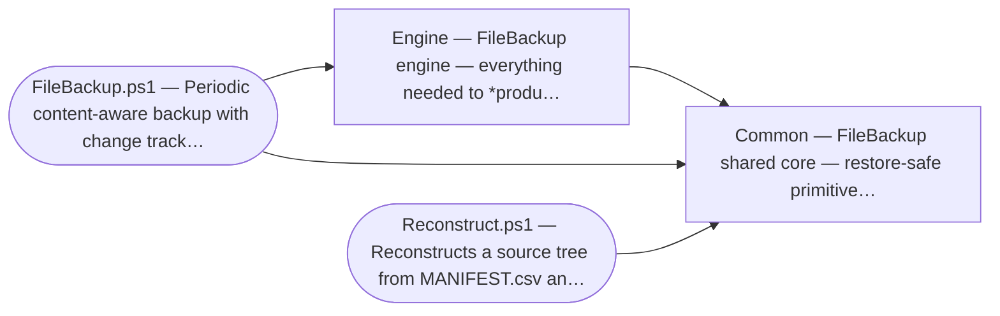

# Architecture (one page)

Owned by the **Software Engineer** hat. The authoritative architecture, module
map, invariants, and pipeline are already maintained in
[AGENTS.md](../AGENTS.md) (§2 module map, §3 invariants) — **single source of
truth; do not duplicate it here.** This page is the process's thin overview plus
the slot for the *generated* map; link to AGENTS.md for detail.

## High-level flow

Hand-written and small; diagrams are Mermaid fenced blocks (rendered natively by
GitHub and the VS Code preview — see process.md "Diagrams are text"):

See AGENTS.md §2 "Backup pipeline" for the nine steps of the bounded run
(`Invoke-BackupSet`, [plans/bounded-run-loop.md](plans/bounded-run-loop.md)) and
`Reconstruct.ps1`'s restore path.

### Program flow (generated)

The ordered internal calls of the `Invoke-BackupSet` orchestrator, generated
from the AST by `scripts/gen_arch_map.ps1 -Flow Invoke-BackupSet` (the harness
keeps it fresh). Read alongside the hand-written nine-step pipeline in AGENTS.md
§2, which carries the control flow this list omits.

<!-- BEGIN GENERATED FLOW -->
_Generated by `scripts/gen_arch_map.ps1 -Flow Invoke-BackupSet` — the ordered internal calls
in `Invoke-BackupSet`. Keep orchestrators thin: a readable flow here means the routine
delegates instead of computing. Loops/branches are not shown — see the
hand-written pipeline overview for control flow. Do not edit by hand._

**`Invoke-BackupSet`** — Runs one backup set (plan §3) and returns its outcome code: 0 every

1. `Resolve-BackupSetPaths` — Validates the set's SourcePath and resolves (creating if needed) the
2. `Get-StorePathFailureCode` — The status code for a set whose store paths could not be resolved:
3. `Enter-StagingOsLock` — Takes the change root's staging OS lock -- Temp.lock opened with
4. `New-RunMetric` — A zeroed set of run metrics: step timings, per-operation counts, bytes
5. `New-Logger` — Returns a scriptblock logger that appends "<ts> [LEVEL] <msg>" to a file
6. `Read-PriorStateForRun` — The refusals that need a person (plan step 2), then the latest
7. `Complete-RunStep` — Records the time since the previous step mark under a step name.
8. `Assert-SourceNotEmpty` — Stops the run (throws, so the set returns 4) when the source root lists
9. `Clear-InterruptedRunResidue` — Deletes what a killed run leaves behind: the Incoming temp copies, any
10. `Get-PriorBackupDate` — The prior state's completion date: LastBackupRun, or - when the state
11. `Complete-RunStep` — Records the time since the previous step mark under a step name.
12. `Get-StoreObjectIndex` — Indexes every stored object of a backup by name: one listing of the
13. `Complete-RunStep` — Records the time since the previous step mark under a step name.
14. `Move-DamagedStoreObject` — Sets aside every object the run's index found damaged by its listing,
15. `New-ReconstructScript` — Copies the Windows and POSIX restore entry points into the backup root,
16. `Complete-RunStep` — Records the time since the previous step mark under a step name.
17. `Publish-PriorStateSnapshot` — Publishes the prior state as Snapshot_<D> before the run changes
18. `Invoke-BackupRunTestHook` — Calls the module's backup-run test seam, when one is set, with a stage
19. `Complete-RunStep` — Records the time since the previous step mark under a step name.
20. `New-BackupRunContext` — Builds what every capture of one run shares (plan step 4): the roots,
21. `Invoke-LibraryCapture` — Walks the source and captures every file into the latest state (plan
22. `Publish-LatestState` — Finishes the latest state (plan step 6): the final manifest and the
23. `Complete-RunStep` — Records the time since the previous step mark under a step name.
24. `Test-StateChanged` — Whether a run changed the latest state (plan step 7, R7): a row was
25. `Remove-UnchangedSnapshot` — Removes the snapshot a run built when the run changed no row (plan
26. `Complete-RunStep` — Records the time since the previous step mark under a step name.
27. `Move-SupersededObject` — Moves every object in the backup root that no row of the final manifest
28. `Complete-RunStep` — Records the time since the previous step mark under a step name.
29. `New-BrowseViewIndex` — Generates the manifest-derived browse view (SR-062): INDEX.tsv always,
30. `Complete-RunStep` — Records the time since the previous step mark under a step name.
31. `Write-ProbeStatistic` — Emits the three SR-081 per-set summary counter lines through the set's
32. `Write-RunMetric` — Writes a run's metrics to its log: step timings, the work done per
33. `Test-BackupDiskFull` — True when an error record is the destination running out of space,
34. `Write-RunMetric` — Writes a run's metrics to its log: step timings, the work done per
35. `Exit-StagingOsLock` — Releases a staging OS lock taken by Enter-StagingOsLock. Idempotent,
<!-- END GENERATED FLOW -->

## Module responsibilities

| Module | Responsibility | Detail |
|---|---|---|
| `Modules/FileBackup.Common.psm1` | Restore-safe primitives (hashing, manifest I/O, compression, logging) — **bundled into every backup** | AGENTS.md §2 |
| `Modules/FileBackup.Engine.psm1` | Backup-only logic: the bounded run (capture, snapshots, superseded moves, run metrics), retention (prune), the storage-form and object audits (Verify), the browse view | AGENTS.md §2 |
| `FileBackup.ps1` | Thin entry point (import, read config, loop `Invoke-BackupSet`, optional mail) | — |
| `Reconstruct.ps1` | Standalone restore using only the bundled Common module + DLL | — |

Design rules (enforced): **Common must never depend on Engine**; anything
`Reconstruct.ps1` calls must live in Common; pure cores (e.g.
`Test-StateChanged`, `Get-SortedManifestRow`, `ConvertFrom-StoredObjectName`) are
unit-tested, I/O shells are integration-tested; the
9-column manifest schema round-trips only via `Read-/Write-Manifest`.

## Module dependencies (generated)

The call graph between the modules and entry scripts, harvested from the AST —
each arrow is a cross-module call, so a layering violation (an arrow from
`Common` into `Engine`, or from `Reconstruct.ps1` into `Engine`) is visible at
a glance.

<!-- BEGIN GENERATED DEPENDENCY DIAGRAM -->
_Generated by `scripts/gen_arch_map.ps1`: each arrow is a call into another
in-tree module. An arrow from `Common` into `Engine`, or from `Reconstruct.ps1`
into `Engine`, would violate the AGENTS.md §3 invariants. Do not edit by hand._

<!-- END GENERATED DEPENDENCY DIAGRAM -->

<!-- BEGIN GENERATED MODULE MAP -->
_Generated by `scripts/gen_arch_map.ps1` from the modules' AST. Do not edit by hand;
run the generator. Summary = the module's .SYNOPSIS; back-links come from `Implements:` comments._

### `Modules/FileBackup.Common.psm1`

_FileBackup shared core — restore-safe primitives._
Imports (internal): _none_

| Function | Exported | Implements |
|---|:---:|---|
| `Compress-FileWithSevenZip` | yes | SR-004, LLR-004 |
| `Convert-HexToShortName` | yes | SR-003, SR-069, LLR-003, LLR-069 |
| `Convert-ShortNameToHex` | yes | SR-003, SR-069, LLR-003, LLR-069 |
| `ConvertFrom-HashSizeFileName` | yes | SR-069, SR-070, LLR-069 |
| `ConvertFrom-ManifestDateString` | yes | — |
| `ConvertTo-DirectoryAttributeFlag` | yes | SR-065, LLR-065 |
| `ConvertTo-ManifestDateString` | yes | SR-025, LLR-025 |
| `Expand-FileWithSevenZip` | yes | SR-008, LLR-008 |
| `Get-DirectoryAttributeToken` | yes | SR-065, LLR-065 |
| `Get-FileBackupDefaults` | yes | — |
| `Get-FileXxHash` | yes | SR-002, LLR-002 |
| `Get-FreeSpaceBytes` | yes | SR-052, SR-023, LLR-052, LLR-023 |
| `Get-HashSizeFileName` | yes | SR-003, SR-021, SR-069, SR-070, LLR-003, LLR-021, LLR-069, LLR-070 |
| `Get-ManifestWitnessPath` | yes | SR-038, LLR-038 |
| `Get-StoredObjectForm` | yes | SR-068, LLR-068 |
| `Get-VolumeIdentity` | yes | SR-052, LLR-052 |
| `Get-XxHashDllPath` | yes | SR-007, LLR-007 |
| `Initialize-ManifestRowWriter` | no | SR-025, LLR-025 |
| `Initialize-XxHashLibrary` | yes | SR-002, SR-019, LLR-002 |
| `New-Logger` | yes | — |
| `New-RelativePathMap` | yes | SR-034, LLR-034 |
| `Read-Manifest` | yes | SR-025, LLR-025 |
| `Resolve-ExistingAncestor` | yes | SR-052, SR-023, LLR-052 |
| `Sync-FileToDisk` | yes | SR-082, SR-101 |
| `Test-HashSizeFileName` | yes | SR-061, SR-069, LLR-069 |
| `Test-IsVolumeRootPseudoPath` | yes | SR-074, LLR-078 |
| `Test-LegacyStoredObjectName` | yes | SR-061, SR-069, LLR-069 |
| `Test-ManifestWitness` | yes | SR-039, LLR-039 |
| `Test-ShouldCompress` | yes | SR-004, LLR-004 |
| `Write-Manifest` | yes | SR-025, SR-082, LLR-025, LLR-087 |
| `Write-ManifestWitness` | yes | SR-038, LLR-038 |

### `Modules/FileBackup.Engine.psm1`

_FileBackup engine — everything needed to *produce* a backup._
Imports (internal): `Common`

| Function | Exported | Implements |
|---|:---:|---|
| `Add-RunMetric` | no | SR-081, LLR-014 |
| `Add-RunSlowFile` | no | SR-081, LLR-014 |
| `Assert-CurrentStoreForm` | no | SR-061, LLR-060 |
| `Assert-NoUnknownConfigKey` | no | SR-042, LLR-042 |
| `Assert-PrunePrecondition` | yes | SR-046, SR-035, SR-039, LLR-046 |
| `Assert-SingleStoreMount` | yes | SR-059, LLR-150 |
| `Assert-SourceNotEmpty` | no | SR-036, LLR-036 |
| `Assert-StoreVolumePresent` | no | SR-014, SR-040, LLR-014 |
| `Clear-InterruptedRunResidue` | no | SR-017, SR-075 |
| `Complete-PruneDeletion` | yes | SR-046, LLR-046 |
| `Complete-RunStep` | yes | SR-081, LLR-014 |
| `ConvertFrom-StoredObjectName` | yes | SR-069, LLR-069 |
| `ConvertTo-FrozenRow` | no | SR-091, SR-059 |
| `Copy-FileWithHash` | yes | SR-002, SR-059, LLR-002 |
| `Copy-ReHomedDataFile` | yes | SR-045, LLR-045 |
| `Enter-StagingOsLock` | yes | SR-085, SR-086, SR-087, LLR-090 |
| `Enter-StoreMutationLock` | no | SR-085, SR-086, LLR-094 |
| `Exit-StagingOsLock` | yes | SR-085, SR-087, LLR-090, LLR-093 |
| `Format-RunByteCount` | yes | SR-081, LLR-014 |
| `Get-BackupContentIndex` | yes | SR-026, SR-045, SR-047, LLR-047 |
| `Get-BackupKitRevision` | yes | SR-049, LLR-049 |
| `Get-BackupSnapshot` | yes | SR-047, LLR-047 |
| `Get-CaseOnlyCollision` | yes | SR-055, LLR-055 |
| `Get-ConfigValueJsonTypeName` | no | SR-042, LLR-042 |
| `Get-DataFile` | yes | SR-057, SR-074, LLR-057, LLR-078 |
| `Get-EmptySourceMessage` | no | SR-036, LLR-036 |
| `Get-FolderFileSet` | no | SR-064, LLR-062 |
| `Get-LastBackupRun` | yes | SR-005, SR-028, LLR-005, LLR-028 |
| `Get-LastHashRun` | yes | SR-011, LLR-011 |
| `Get-LatestObject` | no | SR-003, SR-053, SR-108 |
| `Get-ListedObjectDamage` | no | SR-049, SR-053, SR-059 |
| `Get-MediaMBPerSec` | yes | SR-020, LLR-020 |
| `Get-PoolSnapshotFolder` | yes | SR-045, LLR-045 |
| `Get-PriorBackupDate` | no | SR-005, SR-035, LLR-005, LLR-035 |
| `Get-PruneBatchExitCode` | yes | SR-040, SR-046, SR-048, LLR-046, LLR-048 |
| `Get-PruneCapacityRefusal` | yes | SR-046, SR-052, LLR-046 |
| `Get-SnapshotDate` | no | SR-047, LLR-047 |
| `Get-SnapshotPrunePlan` | yes | SR-045, SR-047, LLR-045, LLR-047 |
| `Get-SortedManifestRow` | yes | SR-024, SR-025 |
| `Get-SourceDirectoryRecord` | yes | SR-065, SR-074, SR-055, LLR-065 |
| `Get-SourceFileList` | yes | SR-001, SR-055, SR-057, SR-074, LLR-001, LLR-055, LLR-057 |
| `Get-StagingOsLockPath` | yes | SR-085, SR-087, LLR-090, LLR-093 |
| `Get-StorageFormFinding` | yes | SR-049, LLR-049 |
| `Get-StoredFileForm` | yes | SR-049, LLR-049 |
| `Get-StoredObjectCompressedFlag` | no | SR-068, LLR-068 |
| `Get-StoredObjectPrefix` | yes | SR-069, LLR-069 |
| `Get-StoredObjectVerdict` | yes | SR-049, SR-068, LLR-049 |
| `Get-StoreObjectFinding` | yes | SR-003, SR-049, LLR-049 |
| `Get-StoreObjectIndex` | yes | SR-003, SR-053, SR-108 |
| `Get-StorePathFailureCode` | yes | SR-040, LLR-014, LLR-048 |
| `Get-VerifyDestination` | no | SR-049, SR-109 |
| `Import-BackupConfiguration` | yes | SR-042, LLR-042 |
| `Initialize-Dependencies` | yes | SR-019 (required dep), SR-020 (optional deps), SR-016 (non-blocking) |
| `Invoke-BackupRunTestHook` | no | — |
| `Invoke-BackupSet` | yes | SR-001, SR-005, SR-014, SR-036, SR-055, SR-057, SR-085, SR-086, SR-089, SR-091, SR-100, LLR-014, LLR-091 |
| `Invoke-LibraryCapture` | no | SR-001, SR-055, SR-057, SR-067, SR-089, SR-091, LLR-091 |
| `Invoke-PruneEntrySweep` | yes | SR-046, LLR-046 |
| `Invoke-SourceFileCapture` | yes | SR-001, SR-003, SR-011, SR-053, SR-059, SR-067, SR-091, SR-105, SR-108 |
| `Invoke-StagingTestHook` | no | SR-075, LLR-017 |
| `Measure-DuplicateRepairCost` | yes | SR-049, SR-109, LLR-049 |
| `Measure-SampleCompressibility` | no | SR-081, LLR-086 |
| `Move-DamagedStoreObject` | no | SR-049, SR-053, SR-059 |
| `Move-StoreObjectToVerify` | yes | SR-049, SR-109, SR-085, SR-086, LLR-049 |
| `Move-SupersededObject` | yes | SR-005, SR-041, SR-059, LLR-059, LLR-150 |
| `New-BackupRunContext` | no | SR-011, SR-081, LLR-014 |
| `New-BrowseViewIndex` | yes | SR-062, LLR-061 |
| `New-CapturedRow` | no | SR-025, SR-024 |
| `New-ProbeStatistic` | no | SR-081, LLR-086 |
| `New-ReconstructScript` | yes | SR-007, LLR-007 |
| `New-RunMetric` | yes | SR-081, LLR-014 |
| `Publish-LatestState` | no | SR-005, SR-011, SR-065, LLR-005 |
| `Publish-PriorStateSnapshot` | yes | SR-005, SR-007, SR-010, SR-082, LLR-005, LLR-150 |
| `Publish-PruneManifest` | yes | SR-045, SR-038, LLR-045 |
| `Publish-StagedObject` | no | SR-003, SR-004, SR-058, SR-081, LLR-003, LLR-058, LLR-086 |
| `Read-BackupState` | no | SR-011, SR-028, LLR-011, LLR-028 |
| `Read-PriorStateForRun` | no | SR-042, SR-061, SR-081, LLR-014 |
| `Remove-BackupSnapshot` | yes | SR-045, SR-046, SR-040, SR-085, SR-086, LLR-045, LLR-046, LLR-092 |
| `Remove-CommittedPruneResidue` | yes | SR-046, LLR-046 |
| `Remove-UnchangedSnapshot` | no | SR-100, LLR-150 |
| `Remove-VerifyScratch` | no | SR-103, LLR-049 |
| `Repair-BackupStorageForm` | yes | SR-049, SR-024, SR-038, SR-085, SR-086, LLR-049, LLR-094 |
| `Resolve-BackupSetDefaults` | no | SR-042, LLR-042 |
| `Resolve-BackupSetPaths` | yes | SR-014, SR-049, SR-063, LLR-014, LLR-063 |
| `Resolve-CompressionDecision` | no | SR-081, LLR-086 |
| `Resolve-GroupStorageForm` | no | SR-081, LLR-058, LLR-086 |
| `Resolve-OptionalTool` | yes | SR-020 (optional-dependency degradation), SR-016 (non-blocking) |
| `Resolve-ViewRootPath` | no | SR-063, LLR-063 |
| `Set-BackupStateField` | no | SR-005, SR-011, SR-082 |
| `Set-LastBackupRun` | yes | SR-005, SR-028, LLR-005, LLR-028 |
| `Set-LastHashRun` | yes | SR-011, LLR-011 |
| `Test-BackupConfigurationShape` | no | SR-042, LLR-042 |
| `Test-BackupDiskFull` | no | SR-052, LLR-052 |
| `Test-BackupStorageForm` | yes | SR-049, SR-038, SR-040, SR-061, LLR-049, LLR-060 |
| `Test-ConfigValueJsonType` | no | SR-042, LLR-042 |
| `Test-FolderHoldsFile` | no | SR-064, LLR-062 |
| `Test-HashRecalcDue` | yes | SR-011, LLR-011 |
| `Test-IsInfrastructureFile` | yes | SR-022, SR-038, LLR-022, LLR-038 |
| `Test-IsJsonNumber` | no | SR-042, LLR-042 |
| `Test-PoolResolves` | yes | SR-046, SR-045, LLR-046 |
| `Test-PortableRelativePath` | yes | SR-055, LLR-055 |
| `Test-SevenZipSignature` | no | SR-049, SR-068 |
| `Test-StateChanged` | no | SR-005, SR-100, LLR-005 |
| `Test-StorageFormAgreement` | yes | SR-046, SR-049, LLR-046, LLR-049 |
| `Update-BackupSnapshotKit` | yes | SR-049, SR-007, SR-038, SR-085, SR-086, LLR-049, LLR-094 |
| `Write-DirectorySidecar` | yes | SR-065, LLR-065 |
| `Write-KitFile` | no | SR-007, SR-082, LLR-007 |
| `Write-ProbeStatistic` | no | SR-081, LLR-086 |
| `Write-RunMetric` | yes | SR-081, LLR-014 |
<!-- END GENERATED MODULE MAP -->
