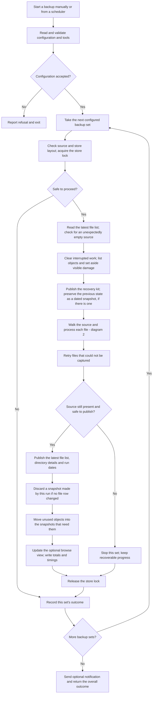
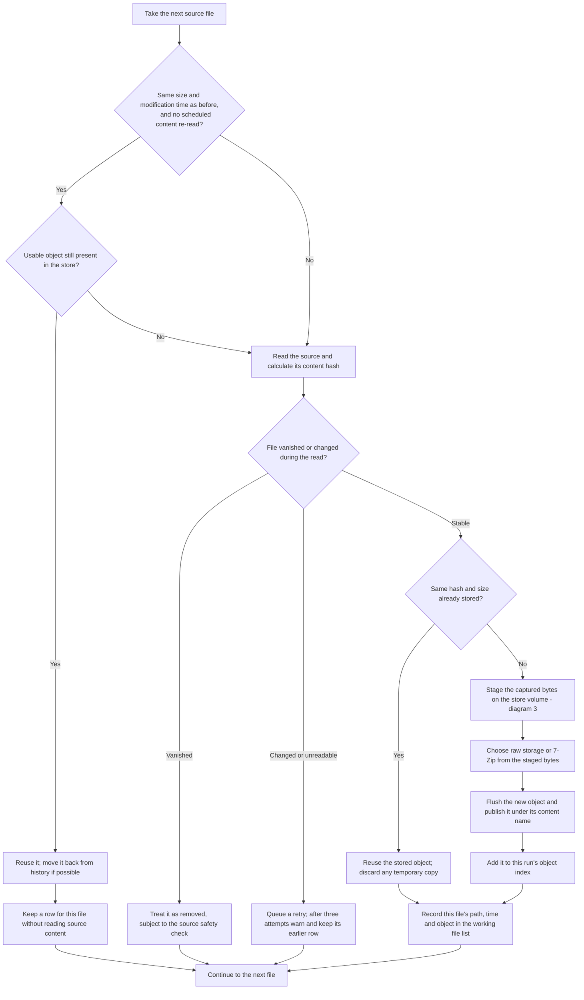
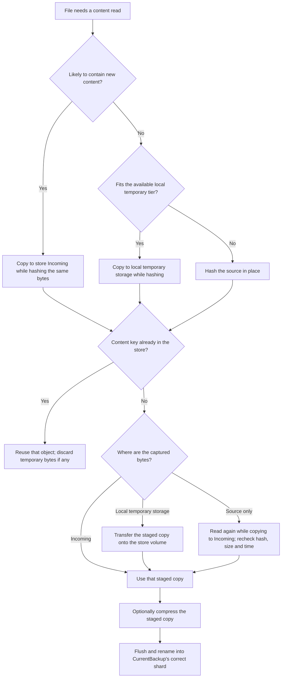

# How a normal backup runs

Reviewed against `Rust-Rewrite` at `45c9a4d`, 2026-11-05. These diagrams describe
the current PowerShell engine. They are a user-oriented view; the generated
function map remains in [architecture.md](architecture.md), and the detailed
rules remain in [AGENTS.md](../AGENTS.md).

The Rust preview retains this main loop, with explicit previous-definition
preservation before mutation and directory/link changes included in history.
Its [native flow/design](plans/native-design-2026-11-05/flows.md),
[implementation bindings](plans/native-design-2026-11-05/implementation-map.md)
and [usage/support limits](native-usage.md) describe the implemented transition.

## 1. One run, from the user's perspective

A configuration can contain several backup sets. Each set pairs one source
folder with one store folder; the sets run sequentially. A failure in one set
does not prevent the others from being attempted.



The previous state's snapshot is published **before files are processed**. It
is named for that previous state's recorded completion date, not today's run.
On the first backup there is no previous state to preserve. A rename, a changed
timestamp or an added duplicate changes a file row and can keep a snapshot even
when no new content has to be stored.

The diagram groups preparation for readability. In the code, prior-state and
empty-source checks precede residue cleanup; residue cleanup precedes the
object listing. Errors after taking the lock release it through the same final
cleanup.

## 2. What happens to each file

The engine first gathers a list of files, then processes that list sequentially.
It includes hidden and dot-named files. It reports invalid names and unreadable
folders, preserving their earlier rows where available. Directory links are
not traversed; link metadata is not preserved. See the
[documented exclusions](../README.md#what-is-not-recorded--read-this-before-relying-on-a-restore).



Deduplication uses **hash plus original length**, across paths, earlier runs,
history and files first seen in this same run. Two identical files get two
logical rows and one stored object. Changing compression settings affects new
objects; it does not recompress existing ones. A snapshot object normally moves
back by rename; if that fails it can still be referenced where it is. Objects
held by very old kits are used without moving them.

## 3. When bytes actually get copied

An unchanged file normally costs a metadata check and object lookup. A file
that needs hashing does not always need another object written to the backup
drive.



“Likely already stored” includes a scheduled re-read of an unchanged-looking
file, or a new path whose length already occurs in the store. It is only a
staging hint; the hash decides whether content is reused. The local tier is
capped per file at 256 MiB or half its measured free space, whichever is less.
If it cannot be used, hashing in place avoids that temporary write.

Compression reads the staged copy, so its content is the content that was
hashed. An archive exactly as long as its original is stored raw. Publication
does not overwrite a live object's bytes. A normal backup does not delete
stored content; removal of history is a separate explicit prune operation.

## 4. What remains on the drive

```text
MyStore/
  CurrentBackup/
    MANIFEST.csv                 latest logical file list
    DIRECTORIES.csv              optional empty-folder / folder-attribute details
    FileBackupState.json         run and full-rehash dates
    RECONSTRUCT.* + dependencies recovery kit
    ab/<content-name>            objects in two-character shard folders
  BackupHistory/
    2026_11_04_03_00_00/
      MANIFEST.csv               that previous state's complete logical file list
      RECONSTRUCT.* + dependencies
      <content-name>             objects stored flat in history
  View/                          optional generated browse pages
  Incoming/                      temporary work
  Verify/                        damaged / duplicate / misplaced objects set aside
  Temp.lock
  backup.log
```

A snapshot is a full **description** of a state, with some of its objects
possibly held elsewhere in the store. Preserve or copy the **whole store** for
reliable recovery. Copying one snapshot folder is not a self-contained data
export. Its kit is self-contained software, but still resolves shared data
from `CurrentBackup` and the other snapshots.

During a long run the engine periodically replaces the latest manifest with a
complete, recoverable checkpoint. That checkpoint can combine files captured
so far with earlier rows for files not reached yet. It is not a promise of an
all-before-or-all-after source tree. The prior snapshot remains the previous
state. Checkpoints are considered between files, normally no more frequently
than once a minute, with longer spacing when writing a manifest is expensive.

Retries are at least 60 seconds after a file's last failed attempt, with three
attempts total. A persistently unreadable file keeps its earlier copy, if any,
and makes the set incomplete. A previously populated source that now looks
empty stops the set with 4; `AllowEmptySource` is accepted but ignored.

## 5. Recovery stays independent of the backup engine


Recovery requires the documented shell/runtime and tools, but no repository,
Rust binary, Cargo or package download during the restore. PowerShell recovery
uses PowerShell 7 plus its bundled Common module and hashing DLL. Bash recovery
uses bash 4+, gawk and xxHash utilities, plus 7-Zip when extraction is needed;
the script has GNU/BSD userland shims. See
[restore instructions](../README.md#3-restore).

## Outcomes and implementation pointers

| Code | What the user should understand |
|---|---|
| 0 | This set completed with every file captured. |
| 1 | The set completed with files not captured, or detected damaged objects. Read the warnings. |
| 2 | The request or store needs correction before proceeding. |
| 4 | The store is busy, or a source, volume or host problem stopped this set. Retry after fixing the cause. |

Across sets, precedence is `2 > 4 > 1`. Optional notification and browse-view
failures do not change an otherwise successful backup into a failed one.

The diagrams follow `Invoke-BackupSet`, `Invoke-LibraryCapture`,
`Invoke-SourceFileCapture`, `Copy-FileWithHash`, `Publish-StagedObject` and
`Get-LatestObject` in [the engine](../Modules/FileBackup.Engine.psm1), with
publication and object-path primitives in [Common](../Modules/FileBackup.Common.psm1).
The interruption, checkpoint and retry examples live in
[BoundedRun.Tests.ps1](../tests/Unit/BoundedRun.Tests.ps1).

Related review: [requirements audit](requirements-audit-2026-11-05.md) and
[Rust migration plan](plans/rust-migration.md).
