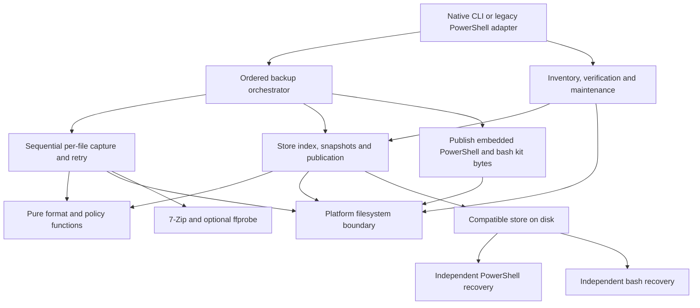

# Initial Rust migration plan

> **Owner review update:** [Review 01](spine-rebaseline-2026-11-05/owner-review-01.md) changes the retention and compatibility basis of this proposal. No older versions are currently designated for support; the continuation and migration milestones below require reconciliation before approval.

Draft for review, 2026-11-05. Based on `Rust-Rewrite` at `45c9a4d`, kit revision
16 and ConfigVersion 3. This is a migration proposal, not an approved new store
format or a request to start modifying production backups.

The recommended path is to **replace the backup and maintenance engine while
keeping the existing on-disk contract and independent PowerShell/bash restore
kits**. Establish compatibility first, then expand native distribution and
measure performance. The [requirements audit](../requirements-audit-2026-11-05.md)
identifies which old requirements cannot safely be copied into the new design.
The [user flow](../backup-flow.md) describes the behavior to preserve.
R0 is now being worked through the
[staged spine rebaseline](spine-rebaseline-2026-11-05.md); its draft needs and
open decisions must be reconciled before the new engine's design is approved.

## 1. Intended result and scope

A user downloads a native executable for Windows, Linux or macOS, supplies a
JSON configuration, and runs a backup without installing PowerShell or .NET
for the backup engine. The resulting store still restores using its bundled
scripts on a recovery machine with the documented tool floor. Neither recovery
route requires Rust, Cargo, the installed backup executable, this repository,
a service or an online download.

Proposed command shape, subject to the existing configuration and IF-001
contracts:

```text
filebackup backup    --config FileBackup.json
filebackup snapshots --config FileBackup.json
filebackup verify    --config FileBackup.json
filebackup verify    --config FileBackup.json --deep
filebackup verify    --config FileBackup.json --repair-storage
filebackup verify    --config FileBackup.json --refresh-kits
filebackup prune     --config FileBackup.json --snapshot 2026_11_04_03_00_00
filebackup prune     --config FileBackup.json --snapshot 2026_11_04_03_00_00 --dry-run
filebackup view      --config FileBackup.json
```

Keep the PowerShell entry point available during transition. A legacy adapter
can preserve parameter names and CLIXML/Windows credential handling until their
replacement is approved. A native JSON CLI can reach a preview release before
all those conveniences are ported; it cannot be called full feature parity.
Native verification and pruning belong in the final migration scope, not only
initial backup and restore demonstrations.

The first port preserves whole-file content addressing and sequential capture.
Link/ACL/xattr/resource-fork fidelity, chunking, encryption, a mandatory database,
multi-host writers, a GUI and a new compression format are separate product
changes. They need their own requirements and recovery story.

## 2. Compatibility contract to freeze before writing

| Surface | Required initial behavior |
|---|---|
| Store layout | One StorePath; CurrentBackup with two-character lowercase shards; flat objects in BackupHistory/date-only snapshots. No automatic adoption of a retired layout. |
| Object identity | Current XXH3-based 128-bit hash plus original length. Uppercase 32-hex manifest hash; exact canonical byte order and unseeded behavior proven by corpus. |
| Object names | Existing 22-character padded base-57 hash, underscore, unpadded base-57 length and opaque extension. No truncation, underscore splitting or extension sanitization. Include uppercase-L-to-l shard vectors. |
| Manifest | The existing nine columns in their existing order and spelling; bare-name DataPath, Hash storage marker, correct duplicate/form metadata, quoted CSV, UTF-8 and existing timestamp semantics. Header-only empty state. |
| Recorded paths | `/` separator, exact Unicode spelling and case for identity; portable-name and collision refusals. No lossy path conversion. |
| File metadata | Per-row modification times; current advisory DIRECTORIES.csv for empty/attributed directories. File permissions, owners, ACLs and other unrecorded metadata gain no new implied guarantee. |
| State publication | Prior snapshot first, recoverable manifest checkpoints, final manifest/directories/run dates, then moves of objects unused by final rows. No normal-run object deletion. |
| Recovery authority | Chosen state's own manifest only; named object, name-index pool resolution, then content-scan fallback. Whole-store recovery, not an isolated snapshot data export. |
| Restore kit | Six required artifacts: RECONSTRUCT.ps1, reconstruct.sh, FileBackup.Common.psm1, System.IO.Hashing.dll, RECONSTRUCT.cmd and RECONSTRUCT.command. No required new witness, path sidecar or Rust helper. |
| Storage form | Raw bytes or current 7-Zip archives; existing byte-based raw/archive discrimination remains sufficient for both scripts. Never reform stored content because settings change. |
| Exclusion | One persistent Temp.lock pathname for backup/prune/repair/refresh; no unlink, heartbeat or age-based takeover. Same-host/same-kernel writers only. |
| Public outcomes | Backup/current restore 0/1/2/4 with 2 > 4 > 1. Preserve prune's legacy-witness 3 path and 2 > 3 > 4 > 1 until explicitly retired. Preserve JSON fields, container actions and environment variables. |

Use existing [hash vectors](../../tests/fixtures/hash-conformance/expected-hashes.csv),
[name vectors](../../tests/fixtures/name-grammar/cases.tsv),
[decoder vectors](../../tests/fixtures/name-grammar/decode.tsv),
[restore fixtures](../../tests/fixtures/bash-restore), and the
[Common writer](../../Modules/FileBackup.Common.psm1) as executable compatibility
evidence. The xxHash specification defines canonical representation using
big-endian order; merely choosing a function with “128” in its name is
insufficient. [xxHash specification](https://github.com/Cyan4973/xxHash/blob/dev/doc/xxhash_spec.md)

Specify CSV empty versus null fields, all-field quoting, doubled quotes,
platform newlines, ordinal path ordering and the round-trip timestamp format.
Match the existing writer's bytes on each host for equal canonical rows. Across
hosts, allow the existing platform newline difference but require identical
logical paths/content and no false state-change snapshot. Test timestamp
precision, time zones and daylight-saving boundaries; preserve unchanged row
values rather than casually round-tripping them through local time.

Also preserve closed-schema behavior, named retired-key errors, exact lowercase
probe modes, and JSON numeric compatibility such as integral `ConfigVersion:
3.0`. Deriving a Rust integer field alone may reject input currently accepted.
`SourceStatePath` and `AllowEmptySource` compatibility behavior must be explicit,
not reactivated because old requirement text mentions them.

## 3. Proposed implementation structure

Start with one Cargo package with a library and thin binary. Split into crates
only when independently reusable boundaries justify it.

```text
rust/
  Cargo.toml, Cargo.lock, rust-toolchain.toml
  src/
    main.rs                CLI dispatch and process outcomes
    config.rs              JSON contract, defaults and legacy-adapter boundary
    model.rs               ContentKey, ManifestRow, RunOutcome, SnapshotName
    format/                CSV, timestamps, names, paths and state files
    engine/                run ordering, walk, capture, retry, checkpoint
    store/                 index, object publication, snapshots and quarantine
    maintenance/           inventory, verify, repair, prune and kit refresh
    platform/              locks, capacity, paths, rename, sync and attributes
    tools/                 7-Zip / ffprobe subprocess adapters
    kits/                  embedded recovery resources and publisher
    reporting/             logs, metrics, JSON and browse view
  tests/                   format conformance and end-to-end scenarios
```

These paths are proposed; no Cargo project is created by this planning change.
Keep the maintained script sources at their current repository paths and
package their exact release bytes. Do not fork a second Common module under
the Rust source tree.



Use typed outcomes instead of a catch-all error becoming “content missing.”
Distinguish file unreadable/changed/gone; store full/gone; refusal/busy; proven
damage versus inability to verify; and warning-only optional features. Retain
earlier rows on capture failure and never write a row before its object is
available to the recovery pool.

Candidate dependencies, to pin and review in the foundation phase:

- Serde/serde_json with explicit unknown-field and numeric validation. Serde
  offers a `deny_unknown_fields` attribute, but FileBackup still needs its
  specific retired-key messages. [Serde attributes](https://serde.rs/attributes.html)
- A streaming CSV implementation configured to match the current serializer;
  defaults are not the contract. Quote style and record terminator are
  configurable in the csv ecosystem.
  [CSV writer options](https://docs.rs/csv-core/latest/csv_core/struct.WriterBuilder.html)
- `xxhash-rust` as a candidate pure-Rust hasher, accepted only after all current
  vectors and streaming chunk boundaries match. Use the explicit 128-bit
  streaming result, not the standard Hasher trait's 64-bit result.
  [Xxh3::digest128](https://docs.rs/xxhash-rust/latest/xxhash_rust/xxh3/struct.Xxh3.html)

Keep compression as a 7-Zip subprocess initially; changing both the writer and
archive implementation would add an avoidable compatibility variable. Pass
arguments directly through the process API, with no shell interpolation. Keep
ffprobe optional and preserve the existing compression-probe policy and effort
environment override. A Cargo lockfile and recorded notices are release inputs.

## 4. Filesystem work that needs an early spike

| Boundary | Required design/proof |
|---|---|
| Lock interoperability | Windows handle sharing compatible with .NET FileShare.None; Unix flock compatible with the existing PowerShell runtime. Test PS holder/Rust contender and the reverse, including kill/release and permission failures. Fail closed if locking is unavailable. |
| Rename versus copy | Verify store, CurrentBackup and BackupHistory can participate in required renames. Local-temp-to-store can cross volumes: implement explicit copy and cleanup when needed, then flush before publication. |
| Object publication | A no-replace operation for immutable object destinations, separately from replace-existing manifest/state publication. Never rely on an unchecked existence test followed by an overwriting rename. |
| Durability | Flush buffered data, sync the file before the rename/commit, and propagate sync errors. Decide and test directory-metadata durability per platform; document process-kill versus power-loss limits. |
| Source consistency | Share/read behavior on Windows; detect size/time changes around reads on every host. Name objects after bytes actually copied. A live application database is not made transaction-consistent merely by Rust or file hashing. |
| Paths and containment | Native Path/OsString at I/O boundaries. Validate before UTF-8 serialization; report nonrepresentable names instead of replacement characters. Resolve existing ancestors for nonexistent targets and handle symlinks/junctions at containment checks. |
| Filesystem identity | Test mounts, bind mounts, removable media, case sensitivity, timestamp precision and inability to measure free space. Do not infer mount identity from path prefixes or drive letters alone. |
| Quarantine/prune | Proven damage only; never quarantine an unreadable object as if comparison completed. Re-home last-copy data, publish destination row changes, prove survivors resolve, then commit prune by rename. |

Rust's standard file-lock API uses flock on Unix and LockFileEx on Windows;
that does not establish equivalence to Windows share-denial semantics. Windows
OpenOptions extensions expose share mode. Choose a platform adapter and prove
interoperation instead of assuming one portable call reproduces the old lock.
[Rust file locking](https://doc.rust-lang.org/std/fs/struct.File.html#method.try_lock),
[Windows share mode](https://doc.rust-lang.org/std/os/windows/fs/trait.OpenOptionsExt.html#tymethod.share_mode)

`std::fs::rename` replaces an existing destination and fails across mounts,
so it is not the whole object-publication or staging-transfer implementation.
Also, dropping a File ignores close errors; explicitly handle sync failures.
These are implementation constraints, not proof of a complete crash-durability
protocol. [Rust rename](https://doc.rust-lang.org/std/fs/fn.rename.html),
[Rust File / sync_all](https://doc.rust-lang.org/std/fs/struct.File.html#method.sync_all)

## 5. Keeping recovery independent

1. Bundle the exact released script/module/DLL/launcher bytes in release assets
   or the executable. Resolve and verify the hashing DLL at build/package time;
   a native backup must not need NuGet to assemble a recovery kit.
2. Publish the six required files through the same compare/write-temp/sync/rename
   discipline. Preserve existing snapshot kits by default; refresh remains an
   explicit operation. Include dependency provenance and required notices in
   release packaging and reconcile backup-folder notices under audit A19.
3. Keep Common restore-safe and independent of the Rust engine. Changes to
   Common still count as kit changes. Bump both script markers together only
   when bundled behavior changes; a Rust engine-only change need not invent a
   new kit revision.
4. Require a clean recovery test machine with the Rust executable and repository
   unavailable and network disabled. Restore raw and compressed latest states
   and snapshots, including stale/blank DataPaths, with each supported script
   route. Compare bytes with an independent expected tree and SHA-256, not just
   a manifest produced by the writer under test.
5. Exercise corrupted objects, mislabelled archive/raw forms, same-sized raw
   source archives, missing data, broken manifests and target I/O errors. Correct
   failure classes and safe continuation are part of compatibility.

“Native recovery” here means the script route appropriate to the target with
its prerequisites installed. Windows PowerShell 5.1 is still insufficient for
the current PowerShell kit; use PowerShell 7 and the bundled module/DLL. On
macOS, the bash script itself checks for bash 4+, gawk and xxHash, with 7-Zip
needed for actual archive extraction. Preserve GNU/BSD shims and the `.command`
launcher; check its executable bit after packaging/copying.

A macOS setup guide can provision
[bash](https://formulae.brew.sh/formula/bash),
[gawk](https://formulae.brew.sh/formula/gawk),
[xxhash](https://formulae.brew.sh/formula/xxhash) and
[sevenzip](https://formulae.brew.sh/formula/sevenzip) before an offline restore.
Package-manager availability is not evidence that a stock machine already has
the tool floor. Removing that preparation requirement would be a separate
recovery project; it must not silently add a Rust dependency to the scripts.

## 6. Incremental delivery and gates

| Phase | Deliverable | Exit evidence |
|---|---|---|
| R0 — Agree on the baseline | Disposition of audit A01..A24; corrected registry loading/shape; supported format/config/kit matrix; current behavior contract and reference fixtures. | No invisible empty registries or shifted CSV fields; pending feature requests distinguished from delivered behavior; repeatable current-engine baseline; same-second snapshot identity adjudicated. |
| R1 — Portable core and platform spikes | Cargo package, pure format/name/hash/config functions, typed outcomes, filesystem adapter experiments and kit packaging proof. No user-store mutation. | All hash/name/CSV/time/config vectors pass on Windows/Linux/macOS; PS/Rust lock tests; no-replace/replace/sync/mount semantics established. |
| R2 — Read-only preview | Inventory, ordinary/deep verification and diagnostics. | Findings match current engine on clean/damaged/mixed-form fixtures; no persistent store changes; bounded memory; valid JSON; host failures not labelled as damage. |
| R3 — Backup preview on disposable stores | Full ordered run, source walk, per-file staging/dedup, compression, retries, checkpoints, snapshots and recovery kit publication. | Differential D1-D4 timelines, no-op byte stability on each host, duplicate-once assertions and both-script recovery after every interruption seam. No production-store write support yet. |
| R4 — Continuation and maintenance | Continue compatible stores in either implementation; prune, repair, refresh and browse behavior. | PS→Rust→PS and Rust→PS→Rust timelines; every retained state restores; prune last-copy/failure/residue cases; no normal-run object deletion; lock interoperability for every mutator. |
| R5 — Native distribution and release candidate | Native binaries, offline release bundles, compatible OCI entry point, supported legacy/mail adapter, CI matrix and user guidance. | Native platform jobs, isolated offline restores, measured budgets, package/notices checks, IF-001 contract tests and a documented rollback rehearsal. |
| R6 — Controlled adoption | Opt-in use, then default selection after release evidence and issue review. | Start with a copied store or new store, compare restored trees, retain the old executable and original store until the transition is accepted. Remove the old engine only after an explicit support decision. |

R1 and R2 are the first implementation milestone. They produce something
reviewable without risking stored history. Estimate later phases after the
format and filesystem spikes; a calendar commitment before those results would
hide the largest uncertainties.

Do not run both implementations as concurrent writers. Differential tests use
separate cloned stores and controlled clocks. Before continuing a real existing
store, establish that it is the supported layout; do not automatically call
kit refresh or repair to make it acceptable.

## 7. Acceptance matrix

| Axis | Initial required cases |
|---|---|
| Native hosts | Windows x86_64, Linux x86_64, macOS Apple Silicon and Intel. Add Windows ARM64 and Linux aarch64 as supported release targets once native runners and restore evidence exist; build-only artifacts are preview. |
| Filesystems | NTFS on Windows, ext4 on Linux, APFS on macOS including a case-sensitive variant; exFAT transfer roundtrip. Separate FAT32 >4 GiB limit, USB removal/full volume and NTFS-through-FUSE cases. Network/cloud/multi-host guarantees remain outside the initial safety claim. |
| Writer / reader | Each writer host → PowerShell restore on Windows, bash restore on Linux and macOS. Include PowerShell on POSIX where claimed supported. Continue a moved store from another host and change drive letters/mount paths. |
| History | Initial, edit, rename, move, duplicate addition, delete, re-add, time-only change, unchanged run, distinct completions within one second; snapshot authority and missing-BackupHistory restore behavior. |
| Capture | Hidden/dot files, reserved root records versus nested data names, portable invalid names, case/Unicode collisions, empty directories, locked/changing/deleted files and unreadable root/subtree. |
| Format / form | Blank/stale DataPath, shard l, opaque/empty extensions, maximum accepted name values, quoted CSV characters, native line endings, raw .7z source and mixed compressed/raw pool. |
| Failure and maintenance | Kill before/after publication boundaries, full disk, missing mounts, failed move-back, wrong-length objects, incomplete verification, interrupted kit refresh/repair, prune commit and cleanup, dry-run no mutations. |
| Scale | Whole-process-tree peak RSS, throughput, history scaling, checkpoint cost and bytes copied/read. Reference corpus and budgets from audit A18, including no full rehash due for the incremental target. |

Reuse the existing Pester and bats scenarios as external black-box acceptance
tests where possible; add a Rust backend to shared fixtures rather than
discarding those regression histories. Retain the original script tests in CI.
Unit-test pure Rust policy/format code; integration tests must also launch real
processes and exercise actual filesystem behavior. Simulated exceptions alone
do not prove OS-lock release or power-loss behavior.

Gate releases with `cargo fmt --check`, Clippy, Rust tests, the adapted
requirements/docs/generated-map checks, the existing PowerShell and shell
checks, and the platform acceptance matrix. Teach the architecture generator
about the Rust surface when it exists; preserve the existing generated
PowerShell blocks until that migration is deliberate.

## 8. Packaging, operations and rollback

Distribute versioned archives containing the native binary, example v3 JSON,
recovery resources, checksums and dependency notices; choose a declared minimum
OS/toolchain and CPU baseline. Pin the toolchain/MSRV and dependency set during
R1. Do not compile release binaries only for the builder's CPU features.
Sign Windows/macOS delivery artifacts and test macOS quarantine, executable
permissions and Intel/Apple Silicon launches before calling installation easy.

Retain the current container action/env/config behavior while replacing its
internal runtime. Keep non-root operation, read-only source/config, one writable
store mount and the log mount; test current mounted-subfolder refusal cases.
Retain HomeHub's stdout/JSON/metrics and log paths, or coordinate a versioned
contract change. HomeHub's outstanding L9 work is a separate dependency, not
evidence already satisfied by this repository.

The rollback gate is practical: after a Rust run, the retained PowerShell
release must be able to continue that current-format store, and the original
script kits must restore its retained states. Preserve original stores during
early adoption. If continuation cannot be proved, the preview is limited to
new disposable stores; “same CSV columns” alone is not a rollback proof.

## 9. Decisions to close in R0

Recommended defaults are proposals, not changes to earlier Owner rulings:

| Decision | Recommended starting point |
|---|---|
| Supported store generation | Current C44/L9 layout only; older stores keep their own kits and original engine. No in-place layout conversion. |
| Feature changes from the audit | Preserve the ruled bounded loop; defer links, stricter metadata/admission and new total-wait/progress promises into separate work packages. |
| Windows legacy configuration and mail | Preserve via the existing PowerShell/CLIXML boundary until secure native parity is designed; JSON remains the portable public configuration. |
| Compression | Existing external 7-Zip tool and effort setting, optional ffprobe; measure the same staged bytes and keep the current first-seen-object rule. |
| Ordering and parallelism | Sequential first, reproducible traversal/first-seen semantics. Consider bounded workers only after parity, with explicit ownership of dedup keys, publication and memory limits. |
| Native support promise | CLI across all three OS families, with per-architecture release status based on native evidence; scripts and documented prerequisites remain the recovery path. |
| Performance acceptance | Use the drafted scale targets as candidates; provision repeatable reference runs and real budget entries before calling them verified or promising Rust speedups. |

Completion of this migration means native backup and maintenance on the declared
platforms **and** continued independent recovery of every supported retained
state through the shell kits. A successful Rust build or a single backup
roundtrip does not satisfy that completion criterion.
