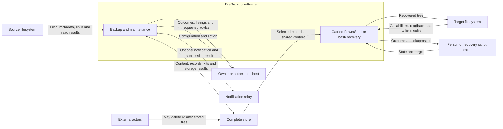

# Boundary review for the approved needs

Status: active external frame approved by the owner; see the
[approval record](boundary-approval.md). B-24 is excluded. The assumptions
remain Drafted, and the 49 approved needs are unchanged. The review below
records the preparation and cross-review leading to that approval.

Review [external.toml](../../requirements/external.toml) next. It describes the
intended product's surroundings and exchanges, including capabilities the
current PowerShell implementation may not yet provide. It does not allocate
Rust modules or choose a new store format.

## What to review

The system includes the backup and maintenance engine, its configuration
helper, and the recovery scripts carried by the store. The engine will be
native on declared Windows, Linux and macOS combinations; recovery remains
available through PowerShell or bash and documented local tools.

The diagram summarizes the main exchanges. Host/tool services, credentials
and release delivery are also part of the registry review below. The store
and target are external filesystem resources; the carried recovery program
is part of FileBackup when executing.

| Review group | Registry rows | Question to check |
|---|---|---|
| Capture and storage | EXT-04/05/13/14/15; B-01..04, B-13, B-20; REL-01/02 | Does this correctly describe a read-only source, a shared content store, coordination within one configuration and the recovery cutoff after history removal? |
| Requests and results | EXT-01/02/03; B-05..08, B-14/15; REL-03..05 | Can a person or automation caller request the supported work and receive an actionable outcome, without assuming advice was read? |
| Recovery and fidelity | EXT-10/11/12; B-16..19 | Are files, names, times, empty folders and supported links covered, with unsupported cases reported and writes confined to the selected target? |
| Host services | EXT-06..09/16; B-09..12, B-21 | Are external tools, conditional provisioning, container access, notification results and protected credentials separate from engine internals? |
| Delivery and support | EXT-17/18; B-22/23 | Does a release communicate supported hosts, prerequisites, assurance limits and explicitly designated compatibility paths? |

There are 18 entities, 23 proposed active crossings and five external
relationships. **B-24 is excluded**: it is an inactive placeholder for a
source-write exception the approved SN-037 does not permit. The old draft
SR-093 and SR-139 still cite it. Reconcile those requirements and retire the
placeholder together; its continued presence is traceability debt, not an
authorized source write. The three stakeholder identity records also retain
their separate Drafted statuses.

## Changes prepared

- Scoped B-04 to the approved single-configuration coordination contract;
  configuration admission still needs its own duplicate-root requirement.
- Made the store handoff and external-deletion relationship reflect the
  retention cutoff. Requested retention information now has explicit request
  and result exchanges, without claiming control over deletion or understanding.
- Included link information at capture and recovery, storage read failures,
  standalone recovery reads, target capabilities and verification readback.
- Distinguished native engine internals from host services and separately
  installed tools. Automatic tool provisioning is conditional, not mandatory.
- Removed the implication that internal store folders require separate
  container mounts, or that every named storage type is supported.
- Added notification submission results, bounded credential-protection wording,
  recovery assurance limits and explicit support/transition guidance.

These are frame corrections derived from the approved needs. They neither
change the running tool nor designate any older version for support.

## Independent cross-review

The owner authorized OpenCode with DeepSeek 4.1 and explicitly approved
sending the needs, frame, assumptions, hats and owner-review notes to that
service. The requested review challenges boundary completeness, unsupported
guarantees, implementation constraints and assumptions that weaken needs.
It is advisory; it cannot approve rows or amend approved needs.

The completed [DeepSeek report](deepseek-boundary-review.md) reviewed the
draft at `3f8c2db` through `opencode-go/deepseek-v4.1-flash`, the working
subscription route. It confirmed receipt of all five complete documents and
returned nine findings. Its verdict was **conditionally ready for owner review,
not ready for approval as-is**. The dispositions below explain the corrections
made after that verdict; DeepSeek has not re-reviewed those corrections.

Earlier requests used the non-subscription route (insufficient funds) and a
free route (no response). The initial subscription review exposed OpenCode's
50 KB per-file attachment limit, so that incomplete report was discarded.
The successful rerun attached each document separately with an end marker,
used a fresh temporary working directory, and disabled external plugins and
all tool permissions. Its complete response wording is preserved.

| Finding | Disposition |
|---|---|
| 1 — nonmutating checks versus logging | **Corrected EXT-15/B-20.** Checks and retention reports leave the entire store unchanged, including operational records and views; results go to the caller. The proposed distinction between protected content and other store files would weaken SN-030, so no such exemption was introduced. |
| 2 — unattended configuration refusal | **Partly accepted; clarified B-08.** Refusal outcomes and diagnostics identifying conflicting configuration entries reach the automation caller. SN-045 requires a machine-readable outcome class, but explicitly requires machine-readable detailed findings only for listings/checks. A structured schema for every configuration diagnostic was not added as a new obligation. |
| 3 — checks of history outside the recovery window | **Owner/SR clarification below.** No approved need or check scope changed. |
| 4 — DA-14 change-detection premise | **Queued for assumptions review.** The size/time heuristic cannot exclude SN-007's scheduled content re-read cases. |
| 5 — DA-08 name representability | **Queued for assumptions review.** Name collisions must still be detected and reported under SN-032. |
| 6 — native release or container | **Corrected B-22.** Native bundles cover declared OS/CPU combinations; a container does not substitute for native delivery. |
| 7 — DA-17/SUR-01 evidence scope | **Queued for assumptions review.** Windows mapped-drive evidence cannot establish Linux/macOS or other filesystem behavior. |
| 8 — death of lock holder | **Clarified B-04** using SN-039's ends-or-dies wording, including interruption and crash under declared host assumptions. |
| 9 — inactive B-24 still represented as Drafted | **Deferred with its citing SR-093/139.** Do not invent an unsupported registry status or break references. B-24 remains excluded from proposed approval and may not justify a source write. Machine-readable retirement and coverage treatment must be reconciled with those references. |

### One point for your review: checking older folders after retention

**Proposed interpretation:** a whole-store check still examines every remaining
state record, including older folders outside the supported recovery window,
and reports missing or inconsistent content there. Being outside the window
does not make a damaged state clean; failure does not, by itself, mean a newer
retained state is damaged. This preserves SN-030's check scope and SN-029's
permission to withdraw older recovery.

The owner accepted this interpretation with the frame approval. A future report
could distinguish findings by recovery window, but how the cutoff is known
(especially after direct external deletion) and how results are grouped belong
in the system requirements. Automatically ignoring older folders or reporting
the whole store clean despite known missing content would require an explicit
change to the approved check need; neither has been assumed here.

The completed local checks found zero spine integrity errors and zero broken
documentation links. The existing 119 orphan relationships and interface debt
remain; these checks do not establish semantic completeness or approval.

## Assumptions review follows

Review [assumptions.toml](../../requirements/assumptions.toml) after the frame.
The following are work items, not accepted environmental excuses:

| Rows | Review needed |
|---|---|
| DA-01/02/03/15 | Separate publication, process interruption, power-loss durability and coordination; bind claims to declared host/filesystem behavior. A process-kill test is not evidence of power-loss durability. |
| DA-04/14/21 | Separate per-file read stability and change detection from a wholly quiescent source. Concurrent source activity must not erase the bounded retry, preserved earlier-copy and visible-failure obligations. DA-21 may describe a test fixture rather than a product prerequisite. |
| DA-05/11 | Align collision and record-substitution limits with SN-025/033. Non-adversarial damage can still leave an internally consistent but wrong record; passing checks is not authentication. |
| DA-06 | Treat reported capacity as an estimate; unavailable measurements and later exhaustion must still meet safe-failure needs. |
| DA-07/08 | Define supported name, time, attribute and link behavior, including collisions and unsupported cases; do not assume away required reporting. |
| DA-09/10/13/18 | Separate operator action, installed recovery tools, container enforcement and external-tool correctness from what FileBackup must check or report. |
| DA-16/19 | Distinguish display dates and state identity; a complete transfer cannot restore content already removed by retention. Store handoff must be described within the retained recovery window. |
| DA-17 and SUR-01/02 | Keep test stand-ins distinct from evidence for real Windows, Linux and macOS filesystems. |
| DA-20 | Match credential access assumptions to supported mechanisms without imposing owner-account-only behavior that the approved need does not demand. |
| DA-12/22 | Make capture exclusions and host-suspension limits explicit without converting implementation conveniences into blanket product assumptions. |

After frame and assumption review, reconcile the system requirements against
the approved needs, then derive design requirements and attach code and
verification evidence. Concrete link classes, supported OS/CPU/filesystem
combinations, resource budgets and any future migration path belong in that
decomposition. They are not silently selected by this frame review.
