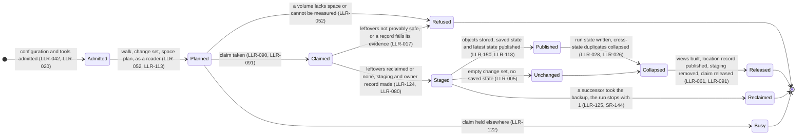
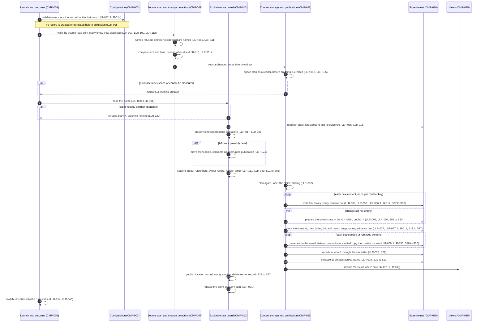
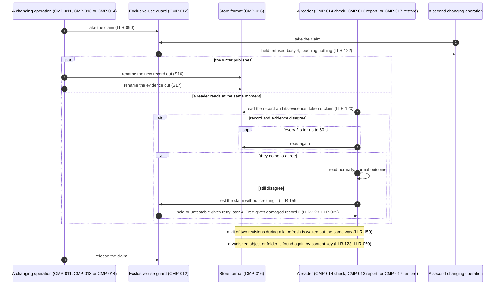
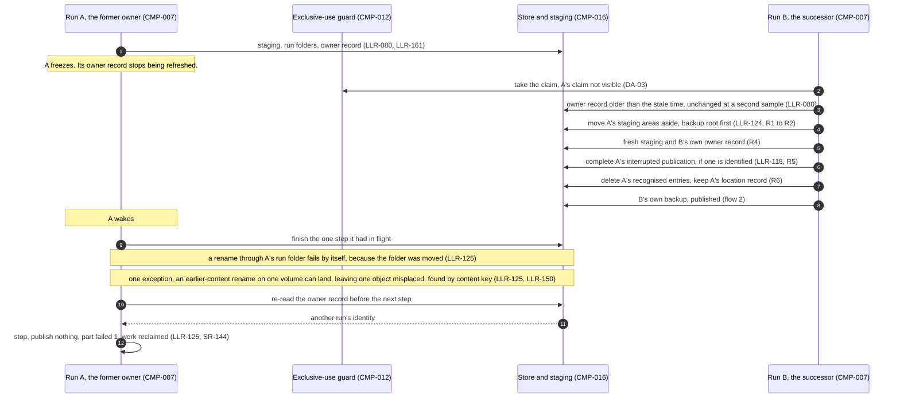
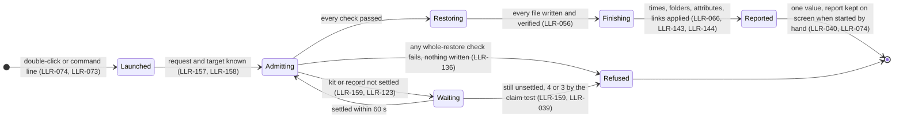
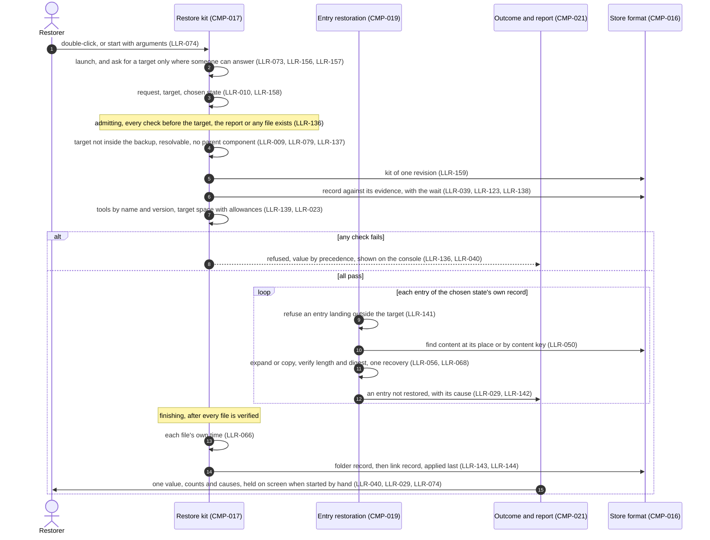
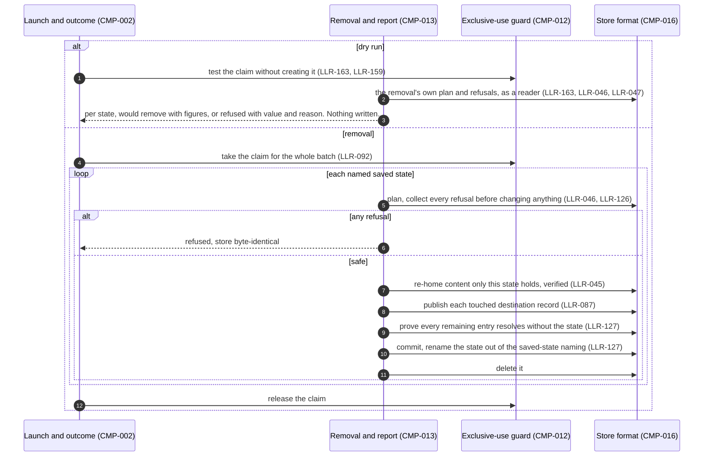
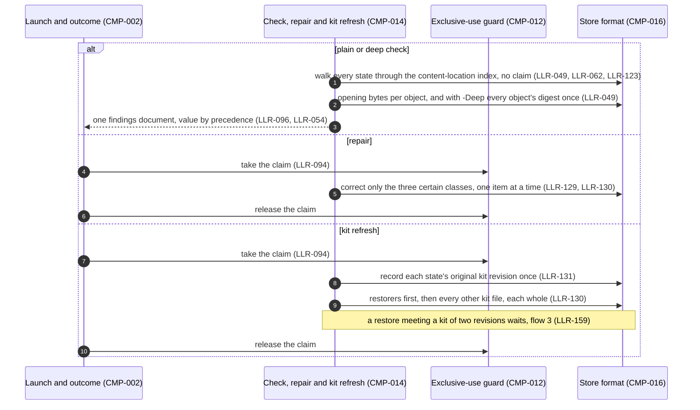
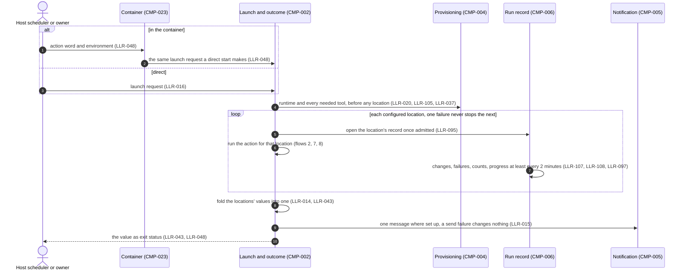

# Runtime flows — FileBackup (authored with the LLRs, before the test-case review)

The authored half of FileBackup's architecture record. Each diagram renders a
key runtime scenario from the design tier in
[requirements/](requirements/) and cites the SR and LLR ids it renders, so a
reviewer can check ordering, concurrency and what blocks on what here first,
then spot-check the rows. The structural half (components, interfaces, which
LLR sits where) is the registries themselves:
[components.toml](requirements/components.toml),
[interfaces.toml](requirements/interfaces.toml) and
[low-level-requirements.toml](requirements/low-level-requirements.toml).

Participants are **components** (`CMP-NNN`), not code modules: the design names
components, and the code is mapped to them later by `Component:` headers. A
flow renders what the rows say; where a row and a flow disagree, the row wins
and the flow is fixed in the same change.

Each scope also carries a **state flow** (the modes a stakeholder could name
and what moves the run between them), as the decomposition method asks. The
per-scope boundary and dependency analysis that goes with these flows is in
[plans/spine-restructure/derive/r3o-decomposition.md](plans/spine-restructure/derive/r3o-decomposition.md).

## Runtime flows

### 1. A backup run: the modes of one location

### 2. A backup run, one location, in order

Renders SR-005, SR-052, SR-059, SR-082, SR-085 and the staging table's steps
S01 to S27 (LLR-162) at the level a reviewer reads them.

### 3. Readers beside a writer (concurrent)

A check, the saved-state report and a restore take no claim and still
complete while a backup, a removal, a repair or a kit refresh holds the
backup. Renders SR-106, SR-085 and SR-086.

### 4. A stale run reclaimed, and the former owner resuming (concurrent)

Only possible where the second run cannot see the first run's claim: two
hosts or containers on one backup, which is unsupported (DA-03), or a network
share that dropped a sleeping host's claim. Renders SR-075, SR-144 and the
reclaim steps R1 to R6 (LLR-162).

### 5. A restore: the modes

### 6. A restore, in order

Both routes (the language runtime and the shell) follow the same flow; parity
between them is a test question. Renders SR-145, SR-039, SR-010, SR-056 and
SR-040.

### 7. A removal, and its dry run

Renders SR-045, SR-046, SR-101 and SR-153.

### 8. A check, a repair and a kit refresh

Renders SR-049, SR-109, SR-110 and SR-117.

### 9. One launch across locations, directly or in the container

Renders SR-014, SR-016, SR-048 and SR-015.

_Update a flow in the same change that alters its LLRs: a stale flow is a
design error._
